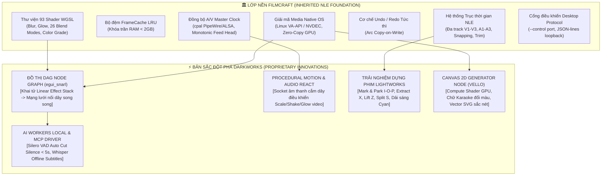

# BẢN ĐỒ PHÂN ĐỊNH TÍNH NĂNG: FILMCRAFT vs. DARKWORKS
@project: DARKWORKS (GPU-Accelerated Node-Driven Video Editor)
@architecture: FilmCraft Foundation + Darkworks Core Innovations

Tài liệu này phân định rạch ròi **100% ranh giới tính năng**: cái nào thuộc về nền tảng **FilmCraft** (hạ tầng kế thừa để không phát minh lại bánh xe) và cái nào thuộc về **Darkworks** (bản sắc riêng, tính năng đột phá mang tính cách mạng).

---

## 🗺️ SƠ ĐỒ PHÂN TẦNG KIẾN TRÚC TOÀN HỆ THỐNG

---

## 📊 BẢNG MA TRẬN PHÂN ĐỊNH RẠCH RÒI TÍNH NĂNG

| Nhóm Tính Năng | Tên Tính Năng | Thuộc Về | Mô Tả Kỹ Thuật Chi Tiết |
| :--- | :--- | :---: | :--- |
| **Media Engine** | **VA-API Hardware Video Decode** | **FilmCraft** | Giải mã phần cứng native Linux qua `/dev/dri/renderD128`, không dùng subprocess CLI ffmpeg, ánh xạ thẳng sang `wgpu::Texture`. |
| **Media Engine** | **FrameCache LRU < 2GB** | **FilmCraft** | Bộ đệm vòng LRU 2 cấp khóa cứng RAM < 2048MB, dọn dẹp vi mô $O(1)$ ngoài khóa Mutex. |
| **Media Engine** | **Native Demuxers** | **FilmCraft** | Đọc trực tiếp container ISOBMFF (MP4, MOV) và Matroska (MKV) thuần Rust. |
| **Audio Engine** | **Audio Master Clock & A/V Sync** | **FilmCraft** | Đồng bộ hình theo tiếng bằng `cpal`, con trỏ Monotonic Audio Feed Head triệt tiêu đứt gãy pha. |
| **Audio Engine** | **Audio Mixer & VU Peak Meters** | **FilmCraft** | Mixer âm thanh đa kênh, faders, pan, solo/mute, đồng hồ đo chuẩn broadcast. |
| **Project State** | **Instant Undo/Redo (`Arc<Project>`)** | **FilmCraft** | Quản lý trạng thái bất biến CoW, bấm `Ctrl+Z` / `Ctrl+Y` tức thì với chi phí RAM cực thấp. |
| **Project State** | **Media Bin & Metadata Tags** | **FilmCraft** | Quản lý thư mục, import media, tạo bin, thumbnail preview, metadata. |
| **Shaders** | **Kho tàng 93 WGSL Shaders** | **FilmCraft** | 93 shader chuẩn mực (Blur, Glow, Vignette, 26 Blend modes, Color Transform). |
| **Automation** | **Desktop Control Protocol** | **FilmCraft** | Cổng điều khiển TCP JSON-lines loopback (`engine.execute`, `ui.menu.invoke`). |
| **Hiệu Ứng** | **Đồ Thị DAG Node Graph (`egui_snarl`)** | ⚡ **Darkworks** | **ĐỘT PHÁ:** Cắt bỏ hoàn toàn bảng Linear Effect Controls của FilmCraft; thay bằng mạng lưới đồ thị nối dây trực quan, cho phép rẽ nhánh, tái sử dụng luồng hình ảnh. |
| **Hiệu Ứng** | **93 Atomic Nodes & `.preset.json`** | ⚡ **Darkworks** | **ĐỘT PHÁ:** Bọc toàn bộ 93 shader của FilmCraft thành các Node nguyên tử độc lập có socket In/Out, hỗ trợ xuất/nạp cụm node thành preset JSON. |
| **Âm Thanh** | **Procedural Motion (Audio Reactivity)** | ⚡ **Darkworks** | **ĐỘT PHÁ:** Socket âm thanh (Peak RMS, Pitch) cắm dây trực tiếp điều khiển Scale, Shake, Glow video thời gian thực. |
| **Timeline** | **Lightworks Mark & Park UX** | ⚡ **Darkworks** | **ĐỘT PHÁ:** Phím tắt tốc độ cao `I`, `O`, `P`, `X` (Extract), `Z` (Lift), `S` (Split), dải sáng Cyan Highlight toàn tracks. |
| **Đồ Họa 2D** | **Vello + Cosmic-text Canvas 2D Node** | ⚡ **Darkworks** | **ĐỘT PHÁ:** Generator Node vẽ chữ Karaoke nhảy màu, vector SVG bằng Compute Shader trên VRAM (tiết kiệm 1GB RAM do không nhúng Web Browser). |
| **AI Local** | **⚡ Auto Cut Silence (Silero VAD)** | ⚡ **Darkworks** | **ĐỘT PHÁ:** Tự động dò khoảng lặng và thực hiện Extract/Ripple Delete toàn bộ khoảng im lặng dưới 5 giây. |
| **AI Local** | **Offline Whisper Subtitle Generator** | ⚡ **Darkworks** | **ĐỘT PHÁ:** Nhận diện giọng nói offline tiếng Việt/Anh, tự động gắn clip phụ đề lên Timeline và nối dây vào Node Karaoke. |
| **Kho Preset** | **Thư Viện Preset `.preset.json` Lưu Sẵn** | ⚡ **Darkworks** | **ĐỘT PHÁ:** Export/Import `.preset.json` giữ đủ dây nối & vị trí node; duyệt/áp 1-click hoặc nối tiếp (Chain) thay bảng `Effects` cũ. |
| **Hoạt Ảnh** | **Node Keyframes & `KeyframeCurve` Node** | ⚡ **Darkworks** | **ĐỘT PHÁ:** Đặt keyframe theo `Tick` (`Hold`/`Linear`/`Ease`) trực tiếp trên Node và xuất tín hiệu Spline cắm dây điều khiển nhiều Node cùng lúc. |
| **Dọn UI Cũ** | **Thay Thế & Xóa `Effects` / `Effect Controls`** | ⚡ **Darkworks** | **ĐỘT PHÁ:** Gỡ bỏ dần ➔ xóa hẳn panel `Effects` & `Effect Controls` tuyến tính của FilmCraft sau khi đủ Transform Handles, Audio & Transition Nodes. |

---

## 📁 DANH MỤC TÀI LIỆU CHI TIẾT TRONG `.darkworks-ai/1-overview/features/`

Toàn bộ các tính năng trên đã được biên soạn thành các tài liệu kiểm toán chi tiết trong thư mục [.darkworks-ai/1-overview/features/](file:///mnt/Data/darkworks/.darkworks-ai/1-overview/features/):

1. **[README.md (Chỉ mục Feature Map)](file:///mnt/Data/darkworks/.darkworks-ai/1-overview/features/README.md):** Tổng quan ma trận và điều hướng (`FC-01..05`, `DW-01..08`).
2. **[filmcraft_media_playback.md](file:///mnt/Data/darkworks/.darkworks-ai/1-overview/features/filmcraft_media_playback.md):** Giải mã phần cứng VA-API và quản lý bộ nhớ đệm RAM < 2GB.
3. **[filmcraft_timeline_multitrack.md](file:///mnt/Data/darkworks/.darkworks-ai/1-overview/features/filmcraft_timeline_multitrack.md):** Trục thời gian đa track, Snapping, Trim và Undo/Redo.
4. **[filmcraft_audio_mixer.md](file:///mnt/Data/darkworks/.darkworks-ai/1-overview/features/filmcraft_audio_mixer.md):** Mixer âm thanh, VU meters và đồng hồ Master Clock.
5. **[darkworks_node_graph.md](file:///mnt/Data/darkworks/.darkworks-ai/1-overview/features/darkworks_node_graph.md):** Đồ thị DAG Node Graph, `egui_snarl`, 93 Atomic Shaders và `.preset.json`.
6. **[darkworks_lightworks_editing.md](file:///mnt/Data/darkworks/.darkworks-ai/1-overview/features/darkworks_lightworks_editing.md):** Thao tác Mark & Park chuẩn Lightworks (`I, O, P, X, Z, S`) và dải sáng Cyan.
7. **[darkworks_vello_canvas.md](file:///mnt/Data/darkworks/.darkworks-ai/1-overview/features/darkworks_vello_canvas.md):** Canvas 2D Node thuần GPU Vello, chữ Karaoke đổi màu và vector SVG.
8. **[darkworks_ai_vad_silence.md](file:///mnt/Data/darkworks/.darkworks-ai/1-overview/features/darkworks_ai_vad_silence.md):** Silero VAD băm khoảng lặng và Whisper tạo phụ đề offline.
9. **[darkworks_audio_reactivity.md](file:///mnt/Data/darkworks/.darkworks-ai/1-overview/features/darkworks_audio_reactivity.md):** Cắm dây socket âm thanh điều khiển chuyển động hình ảnh.
10. **[darkworks_node_presets_keyframes_migration.md](file:///mnt/Data/darkworks/.darkworks-ai/1-overview/features/darkworks_node_presets_keyframes_migration.md):** Feature Map & Kịch bản kiểm thử `DW-06`, `DW-07`, `DW-08` (Kho Preset lưu sẵn, Keyframe Node Graph, Xóa `Effects` / `Effect Controls` FilmCraft).
