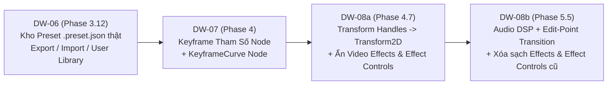

# FEATURE MAP & KỊCH BẢN KIỂM THỬ: KHO PRESET, KEYFRAME & THAY THẾ EFFECTS CŨ (DW-06, DW-07, DW-08)
@project: DARKWORKS | @phases: Phase 3.12 ➔ Phase 4 ➔ Phase 5.5
@target: Checklist nghiệm thu thực tế trên Desktop GUI sau khi triển khai từng chặng

Tài liệu này gom trọn 3 phân hệ nâng cấp giúp Darkworks **thay thế hoàn toàn bảng `Effects` & `Effect Controls` cũ của FilmCraft** bằng hệ sinh thái **Node Graph + Kho Preset `.preset.json` lưu sẵn + Keyframe**.

---

## 🗺️ SƠ ĐỒ PHỤ THUỘC & THỨ TỰ TEST

---

## 📦 DW-06: KHO PRESET NODE GRAPH (`.preset.json` THẬT) — PHASE 3.12
@status: ⚪ Chờ triển khai | @target_crates: `node-graph-core`, `node-graph`, `ui-egui`

### Sub-features
- **Export File `.preset.json` Thật:** Nút `💾 Export Preset` mở hộp thoại `Save As`, lưu toàn bộ `NodeGraphDoc` (`nodes`, `pos`, `custom_title`, `wires`, `groups`) xuống ổ đĩa.
- **Import File `.preset.json`:** Nạp lại file bất kỳ từ ổ đĩa vào chế độ Nháp (`📝 Nháp`), giữ nguyên 100% dây nối, vị trí node và tên tùy chỉnh.
- **Thư Viện User Presets Lưu Sẵn:** Tự quét thư mục preset người dùng + kho preset dựng sẵn, hiển thị thành danh sách chọn/kéo-thả 1-click.
- **Replace vs Chain (Nối Tiếp):** Khi áp Preset thứ 2 lên một Clip đã có Node Graph, người dùng chọn **Thay thế** hoặc **Nối tiếp** vào trước `Final Output`.

### Kịch bản tự test (User POV)
- [ ] **Test 6.1 — Export & Clear & Import giữ nguyên dây nối:**
  1. Dựng đồ thị gồm 3+ node có nối dây (`Video Input` ➔ `Color Grade` ➔ `Blur / Sharpen` ➔ `Final Output`), đổi vị trí và tên 1 node, gom vào 1 `Visual Group`.
  2. Bấm `💾 Export Preset` ➔ chọn nơi lưu file `my_glow.preset.json`.
  3. Kiểm tra trên ổ đĩa thấy tồn tại file `my_glow.preset.json` hợp lệ.
  4. Bấm `🗑 Clear All` ➔ bấm `📥 Import Preset` chọn `my_glow.preset.json`.
  5. **Kỳ vọng:** Toàn bộ node, tọa độ, dây nối, tên node, thông số và `Visual Group` khôi phục đúng 100% và đưa về chế độ Nháp (không ghi đè clip cũ đang chọn).
- [ ] **Test 6.2 — Lưu vào Thư Viện Preset dùng 1-click:**
  1. Lưu một preset mới vào thư mục User Presets.
  2. Mở menu/bảng Preset ➔ kiểm tra preset vừa lưu xuất hiện trong danh sách.
  3. Chọn một video clip khác trên Timeline ➔ áp 1-click preset đó.
  4. **Kỳ vọng:** Clip mới nhận đủ hiệu ứng ngay trên Program Monitor.
- [ ] **Test 6.3 — Áp Preset nối tiếp (Chain) trên cùng 1 Clip:**
  1. Áp Preset `Color Grade` lên Clip A.
  2. Áp thêm Preset `Cinematic Soft Glow` theo chế độ **Nối tiếp (Chain)**.
  3. **Kỳ vọng:** Clip A vừa giữ chỉnh màu cũ vừa có thêm Glow, đồ thị không bị mất node trước đó.

### Gotchas (Các bẫy cần soi kỹ)
- Không được dùng `bound_clip_id` cũ khi Import Preset hoặc mở `Load Preset` (tránh lỗi ghi đè nhầm clip trước đó).
- Tương thích ngược: file `.preset.json` kiểu cũ hoặc mới đều phải báo lỗi thân thiện bằng tiếng Việt nếu JSON hỏng, tuyệt đối không panic/crash.

---

## ⏱️ DW-07: KEYFRAME & `KeyframeCurve` NODE — PHASE 4
@status: ⚪ Chờ triển khai | @target_crates: `node-graph-core`, `node-graph`, `render`, `ui-egui`

### Sub-features
- **Keyframe Trực Tiếp Trên Tham Số `DarkNode`:** Lưu mốc theo `Tick` nguyên thủy; hỗ trợ `Hold`, `Linear`, `EaseIn`, `EaseOut`, `EaseInOut` / Cubic Bezier; có nút `◀ ◆ ▶` theo Playhead.
- **Node `KeyframeCurve` (Spline Signal):** Xuất tín hiệu `Scalar` (`f32`) theo thời gian tuyệt đối (`Tick`) hoặc chuẩn hóa `0% -> 100%` (để đóng gói vào `.preset.json`).
- **1 Đường Lái Nhiều Node & Trộn Procedural:** Cắm 1 `KeyframeCurve` vào nhiều socket `Mod` cùng lúc, hoặc nhân/cộng với `AudioReactor` / `TimeDriver`.

### Kịch bản tự test (User POV)
- [ ] **Test 7.1 — Đặt & Chỉnh Keyframe trực tiếp trên `Transform2D`:**
  1. Chọn Clip A, mở `Transform2D` trong Node Graph.
  2. Đưa Playhead tới giây `0.0s` ➔ bấm nút ◆ đặt keyframe `Position.X = -600`, `Opacity = 0.0`.
  3. Đưa Playhead tới giây `0.5s` ➔ đặt `Position.X = 0`, `Opacity = 1.0`, chọn nội suy `EaseOut`.
  4. Nhấn Play (Space).
  5. **Kỳ vọng:** Hình/Banner trượt mượt vào giữa màn hình và rõ dần trong 0.5s đầu; dùng `◀` / `▶` nhảy chính xác giữa các mốc; `Ctrl + Z` hoàn tác được việc thêm/sửa keyframe.
- [ ] **Test 7.2 — Dùng 1 `KeyframeCurve` Node điều khiển nhiều Node:**
  1. Thêm `KeyframeCurve` Node tạo đường cong `0.0 -> 1.0 -> 0.0`.
  2. Nối đầu ra `Scalar` của `KeyframeCurve` vào cả `BlurSharpen.Intensity Mod` và `Transform2D.Scale Mod`.
  3. Phát Timeline ➔ **Kỳ vọng:** Độ mờ và phóng to biến thiên đồng bộ đúng theo 1 đường cong duy nhất.
- [ ] **Test 7.3 — Lưu & Mở lại `project.json` và `.preset.json`:**
  1. Save Project (`Ctrl + S`), đóng app và mở lại (hoặc Export thành `.preset.json` rồi áp lên clip có độ dài khác đối với chế độ `0% -> 100%`).
  2. **Kỳ vọng:** Toàn bộ mốc keyframe và kiểu Ease được khôi phục chính xác từng frame (`Tick`), file `project.json` cũ không có keyframe vẫn load bình thường (`#[serde(default)]`).

### Gotchas (Các bẫy cần soi kỹ)
- Kéo thả keyframe / scrub timeline không được cấp phát bộ nhớ nặng trong vòng render 60fps; RAM vẫn khóa `< 2GB`.
- Thời gian keyframe bắt buộc tính bằng `Tick` (không dùng `f64` giây gây trôi frame ở video dài).

---

## 🧹 DW-08: THAY THẾ & XÓA SẠCH `Effects` / `Effect Controls` FILMCRAFT — PHASE 4.7 & 5.5
@status: ⚪ Chờ triển khai | @target_crates: `ui-egui`, `engine`, `render`

### Sub-features
- **Giai đoạn chuyển tiếp (Phase 4.7 — Sau khi xong DW-06 & DW-07):**
  - Kéo thả khung Transform trực tiếp trên Program Monitor ăn thẳng vào `Transform2D` Node.
  - Kho **Video & Color Node Presets** thay thế đầy đủ các hiệu ứng phổ biến của FilmCraft.
  - Ẩn `Effect Controls` và nhóm `Video Effects` cũ khỏi giao diện mặc định.
- **Giai đoạn hoàn tất (Phase 5.5 — Xóa sạch hoàn toàn):**
  - Bổ sung Audio DSP Nodes (Volume, Pan, EQ, Audio Crossfade) hoặc xử lý trọn vẹn qua Audio Mixer + Node Graph.
  - Nối cơ chế kéo Preset `Transition` đặt vào điểm nối (Edit Point) giữa 2 clip trên Timeline.
  - Xóa hoàn toàn `PanelKind::Effects` và `PanelKind::EffectControls` khỏi workspace UI (`dock.rs`, `panels.rs`, menu `Window`, phím tắt `Shift+5` / `Shift+7`).

### Kịch bản tự test (User POV)
- [ ] **Test 8.1 — Kiểm tra giao diện sạch bóng `Effects` & `Effect Controls` cũ:**
  1. Mở menu `Window` ➔ `Workspaces` ➔ kiểm tra không còn tab `Effects` và `Effect Controls` của FilmCraft; thanh phím tắt mặc định tập trung vào **Node Graph** và **Thư viện Node Presets**.
- [ ] **Test 8.2 — Kéo khung Transform trực tiếp trên Program Monitor (thay Motion cũ):**
  1. Chọn clip có Node Graph (hoặc clip thường) ➔ kéo góc/tâm trên Program Monitor để di chuyển, xoay, scale.
  2. **Kỳ vọng:** Thông số trên node `Transform2D` cập nhật live (và tự tạo keyframe nếu đang bật keyframe), `Ctrl + Z` hoàn tác gọn 1 bước.
- [ ] **Test 8.3 — Áp Preset thay bảng Effects cho đủ 4 nhu cầu thực tế:**
  1. Áp **Color Preset** lên clip video ➔ đổi màu tức thì trên Program Monitor.
  2. Áp **Video FX Preset** (Blur/Glow/Keyer/Lower-Third) ➔ render mượt 60fps.
  3. Áp **Transition** vào điểm cắt giữa Clip A và Clip B trên Timeline ➔ chuyển cảnh mượt giữa 2 clip.
  4. Chỉnh **Audio Volume / EQ / Fade** trên clip audio ➔ âm thanh phát đúng mức, không rè, không lệch pha.

### Gotchas (Các bẫy cần soi kỹ)
- Tuyệt đối không xóa `PanelKind::EffectControls` trước khi xong `DW-07` (Keyframe) và nối `Transform Handles -> Transform2D`, nếu không sẽ mất công cụ chỉnh vị trí/animation trên màn hình.
- Trước khi xóa `PanelKind::Effects`, phải đảm bảo các test workspace/dock (`crates/ui-egui/src/dock.rs`) và audio/transition đều đã chuyển đường mới và pass 100% (`cargo test`, `cargo clippy`).
