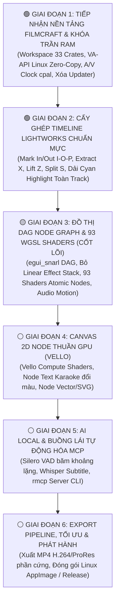

# BẢN KẾ HOẠCH TỔNG THỂ TOÀN DỰ ÁN: DARKWORKS (master-plan-a-z.md)
@project: DARKWORKS (GPU-Accelerated Node-Driven Video Editor)
@authority: Người Dùng (Giám Đốc Dự Án) | @status: 🟢 Hoàn Thành Giai Đoạn 2 (Timeline Lightworks UX) -> Sẵn Sàng Giai Đoạn 3 (Node Graph)
@architecture: Rust Cargo Workspace (33 Crates Lõi + apps/darkworks + apps/darkworks-cli)
@engine: wgpu + egui + egui_snarl + vello | @ram_cap: Khóa cứng < 2GB | @audio_clock: cpal

> **Mục tiêu tài liệu:** Bản kế hoạch tác chiến trung tâm định hình toàn bộ lộ trình phát triển Darkworks theo **Định Hướng 1: Kế thừa 100% nền tảng NLE chuyên nghiệp của FilmCraft, cấy ghép trải nghiệm biên tập đỉnh cao của Lightworks và thay thế Linear Effect Stack bằng Đồ thị DAG Node Graph**.  
> Lộ trình chia làm 6 Giai đoạn (Phases) tuần tự, tập trung tối đa hỏa lực vào giá trị cốt lõi độc nhất (Lightworks UX + Node Graph + Vello Canvas).

---

## 🗺️ TỔNG QUAN LỘ TRÌNH 6 GIAI ĐOẠN (A - Z ROADMAP)

---

## 🟢 GIAI ĐOẠN 1: TIẾP NHẬN NỀN TẢNG FILMCRAFT & KHÓA TRẦN RAM (PHASE 1)
**Trạng thái:** 🟢 **HOÀN THÀNH 100% (2026-11-21)**  
**Mục tiêu:** Kế thừa toàn bộ hệ thống giải mã đa phương tiện, phát video phần cứng 60fps, hệ thống Undo/Redo và quản lý dự án có sẵn của FilmCraft; loại bỏ hoàn toàn mã nguồn updater ngoại lai; khóa trần bộ nhớ RAM `< 2GB`.

- [x] **Task 1.1 [Cấu Trúc Workspace Chuẩn Mực]:**
  - Tích hợp toàn bộ 33 crates nền tảng vào `crates/*` (`crates/media`, `platform`, `codecs`, `render`, `engine`, `project`, `edit`, `time`, `ui-egui`, v.v.).
  - Thiết lập 2 ứng dụng thực thi chính: `apps/darkworks` (Desktop NLE) và `apps/darkworks-cli` (Headless Engine & MCP Server).
- [x] **Task 1.2 [Lõi Giải Mã Phần Cứng OS Native]:**
  - Kế thừa `crates/platform` & `crates/media` giải mã video phần cứng (Linux VA-API / NVDEC), đẩy khung hình trực tiếp lên `wgpu::Texture` (Zero-copy GPU).
- [x] **Task 1.3 [Khóa Trần RAM < 2GB]:**
  - Kế thừa bộ đệm `FrameCache` LRU Ring-Buffer kiểm soát dung lượng khung hình giải mã luôn dưới 2GB RAM.
- [x] **Task 1.4 [A/V Clock Sync Master]:**
  - Kế thừa engine âm thanh `cpal` đồng bộ A/V qua PipeWire/ALSA với Audio Clock làm Master.
- [x] **Task 1.5 [Hệ Thống Undo / Redo Toàn Cục]:**
  - Kế thừa cơ chế `Arc<Project>` Copy-on-Write từ `crates/engine`: mọi thao tác qua `Session::execute` đều tự động lưu snapshot, bấm `Ctrl + Z` (Undo) và `Ctrl + Y` (Redo) tức thì mà không tốn RAM.
- [x] **Task 1.6 [Cắt Bỏ Triệt Để Updater Ngoại Lai]:**
  - Xóa vĩnh viễn dependency `craft-update`, xóa popup modal cập nhật `FilmCraft 0.20.1`, tách rời Darkworks độc lập 100%.
- [x] **Task 1.7 [Nghiệm Thu Bản Build & Render Frame]:**
  - Biên dịch thành công 100% `cargo check --workspace` và `cargo build --bin darkworks`.
  - Kiểm chứng `darkworks-cli render` trích xuất frame 1080p trong **32.5 ms**.

---

## 🟢 GIAI ĐOẠN 2: CẤY GHÉP TIMELINE LIGHTWORKS CHUẨN MỰC (PHASE 2)
**Trạng thái:** 🟢 **HOÀN THÀNH 100% (2026-11-21)**  
**Mục tiêu:** Cấy ghép triết lý biên tập đỉnh cao của **Lightworks** vào Timeline chuyên nghiệp của Darkworks: cơ chế Mark & Park (In/Out), bộ phím tắt tốc độ cao (`I`, `O`, `P`, `X`, `Z`, `S`), và dải màu Cyan highlight phủ toàn bộ chiều dọc các track.

- [x] **Task 2.1 [Preset Phím Tắt Chuẩn Lightworks Mặc Định]:**
  - Cập nhật trong `crates/engine/src/shortcut_presets.rs`: đưa preset `DARKWORKS` thành cấu hình mặc định:
    - **`I`**: Đánh dấu **Mark In** (`markers.markIn`).
    - **`O`**: Đánh dấu **Mark Out** (`markers.markOut`).
    - **`P`**: Xóa cả 2 mốc (**Clear In/Out** — `markers.clearInOut`).
    - **`X`**: **Extract** (`sequence.extract` — Xóa dồn đoạn giữa In và Out, dồn timeline về trước).
    - **`Z`**: **Lift** (`sequence.lift` — Xóa rỗng đoạn giữa In và Out, giữ nguyên khoảng trống Gap).
    - **`S`** hoặc **`C`**: **Razor Split** (`sequence.addEdit` — Cắt clip ngay tại vị trí Playhead).
    - **`Shift+S`**: Bật/tắt hít mép timeline (`sequence.snap`).
- [x] **Task 2.2 [Trực Quan Hóa Dải Sáng Cyan Chuẩn Lightworks]:**
  - Trong `crates/ui-egui/src/panels/timeline/ruler.rs` và `timeline.rs`:
    - Vẽ dải phủ màu Cyan highlight mờ (`egui::Color32::from_rgba_unmultiplied(0, 210, 255, 35)`) phủ xuyên suốt toàn bộ chiều cao của các Track giữa mốc In và Out.
    - Vẽ 2 laser line biên độ Cyan tại In và Out.
    - Vẽ 2 mốc ngoặc vuông `[` (In) và `]` (Out) màu Cyan nổi bật trên thanh Ruler.
- [x] **Task 2.3 [Xử Lý Khoảng Trống Gap & Kiểm Thử Thao Tác Cắt Ghép]:**
  - Kiểm chứng Playhead khi di chuyển qua vùng Gap (không có clip) xuất frame đen chuẩn NLE trên Viewport.
  - Kiểm chứng thao tác phím `X` (Extract) và `Z` (Lift) có thể hoàn tác ngay lập tức bằng `Ctrl + Z`.
  - Bộ kiểm thử tự động `drive_feature.py -f lightworks` vượt qua 100% kiểm chứng.
- **Tiêu chuẩn nghiệm thu (DoD 2):** Đánh dấu In/Out bằng `I` và `O`, dải sáng Cyan hiện rõ ràng xuyên suốt các track; bấm `X` xóa dồn vùng chọn, bấm `Z` xóa giữ chỗ; bấm `S` cắt clip; bấm `Ctrl + Z` hoàn tác lệnh cắt/xóa ngay lập tức.

---

## ⚪ GIAI ĐOẠN 3: ĐỒ THỊ DAG NODE GRAPH, BLACK NODE, ACTION NODE & CODE NODE (PHASE 3) - TRỌNG TÂM CỐT LÕI
**Trạng thái:** 🟡 **SẴN SÀNG TRIỂN KHAI**  
**Mục tiêu:** **Cách mạng hóa hệ thống hiệu ứng** — Khai tử danh sách `effects: Vec<EffectInstance>` tuyến tính tuần tự của Premiere/FilmCraft gốc, thay thế bằng Đồ thị DAG Node Graph (`egui_snarl`), hệ sinh thái 10+ Atomic Nodes, Black Node (Compound FX Layer), Action Node (Workflow Automation), ComfyUI Canvas Ergonomics, Code Node (Custom WGSL JIT) và 93 WGSL Shaders.

- [ ] **Task 3.1 [Khởi Tạo Crate `crates/node-graph` & Snarl Canvas UI]:**
  - Tích hợp `egui_snarl` vào UI Darkworks, dựng panel Node Graph trực quan (kéo thả socket, dây cong Bézier, zoom/pan canvas vô cực).
  - Tích hợp công cụ ComfyUI Style: Visual Group/Backdrop, Sticky Note, Reroute Dot, Snap-to-Grid, Minimap.
- [ ] **Task 3.2 [Schema Đồ Thị & Hệ Thống Sockets/Pins]:**
  - Định nghĩa các kiểu Socket: Texture (Xanh lam), AudioFloat (Xanh lá), Scalar/Vector (Vàng), ActionFlow (Tím).
  - Tách bạch cổng nguồn Video: `Track V1`, `Track V2`, `All Below` và định tuyến Background/Foreground trên Blend Node.
  - Xây dựng cơ chế serialization/deserialization đồ thị sang `.preset.json`.
- [ ] **Task 3.3 [Hệ Sinh Thái 10+ Atomic Nodes Nền Tảng]:**
  - `Node Video Source`: Đầu vào hình ảnh từ Clip trên Timeline tại Playhead.
  - `Node Text Generator`: Sinh chữ động dựa trên `crates/text`, xuất texture RGBA có alpha.
  - `Node Shape / Solid`: Vẽ nền hộp bo góc, solid matte cho banner/lower-third.
  - `Node Time / Speed Driver`: Bộ đếm thời gian, tốc độ cuộn ngang Ticker/Marquee, sóng LFO.
  - `Node Crop / Mask`: Cắt xén vùng hiển thị.
  - `Node Transform 2D`: Vị trí X/Y, Scale, Rotation, Anchor point, Opacity.
  - `Node Blend / Mix`: Hòa trộn 2 luồng hình ảnh với 26 chế độ blend (Multiply, Screen, Overlay...).
  - `Node Color Grade`: Chỉnh màu cơ bản (Exposure, Contrast, Temp, Tint, Saturation).
  - `Node Keyer`: Tách phông xanh Ultra Key thời gian thực.
  - `Node AudioReactor`: Trích xuất sóng âm Peak RMS điều khiển rung nảy thông số.
  - `Node Output`: Đầu ra cuối cùng đẩy thẳng lên Viewport / Render Buffer.
- [ ] **Task 3.4 [⬛ Triển Khai Black Node (Compound Subgraph & FX Layer)]:**
  - Cho phép đóng gói (pack) một nhóm các node thành 1 Black Node duy nhất (Anti-Spaghetti).
  - Drill-down mở đồ thị con, bộc lộ các cổng Exposed Pins ra ngoài.
  - Đóng gói cụm node thành file `.preset.json` độc lập; hỗ trợ làm FX Adjustment Layer trên Timeline.
- [ ] **Task 3.5 [⚡ Triển Khai Action Node & Topological DAG Evaluator]:**
  - Xây dựng Action Node tự động hóa: Cấu hình Target Scope (Selected Clips, Track, Vùng In/Out) + Nút bấm `[ ▶ Run Workflow ]`.
  - Bộ duyệt đồ thị phi chu trình Topological Sort phát hiện vòng lặp (Cycle Detection).
- [ ] **Task 3.6 [💻 Triển Khai Code Node (Custom WGSL JIT & Script Node)]:**
  - `Custom WGSL Shader Node`: Viết code shader trực tiếp trong node, wgpu JIT compile < 2ms, Hot-reload 60fps, tự động sinh Socket từ biến uniform. Sẵn sàng cho AI Agent bơm code shader.
  - `Script Action Node`: Chạy Lua script qua `crates/plugin-host` (`mlua`) cho tự động hóa batch logic.
- [ ] **Task 3.7 [Chuyển Đổi 93 WGSL Shaders & Thay Thế Effect Controls]:**
  - Đóng gói toàn bộ 93 file Shader WGSL từ `crates/render` thành catalog Atomic Nodes chuẩn.
  - Thay thế bảng Effect Controls cũ của Premiere bằng Node Graph Panel & Node Inspector.
- **Tiêu chuẩn nghiệm thu (DoD 3):** Mở panel Node Graph 60fps; tạo dải News Ticker (nền xanh, chữ đen, chạy góc dưới) mượt mà 60fps; phân lập effect trên V1 và V2 đè lên trên; gom cụm thành Black Node và xuất `.preset.json`; nhấn Run trên Action Node áp effect hàng loạt vùng In/Out; gõ code WGSL trong Custom Shader Node JIT compile hiển thị tức thì; RAM luôn `< 2GB` và file `< 700 dòng`.

---

## ⚪ GIAI ĐOẠN 4: CANVAS 2D NODE THUẦN GPU (VELLO) (PHASE 4)
**Trạng thái:** ⚪ **CHỜ TRIỂN KHAI**  
**Mục tiêu:** Đưa engine đồ họa vector Vello + Cosmic-text vào mạng lưới Node Graph để tạo chữ Karaoke nhảy màu, biểu đồ, infographic vẽ trực tiếp bằng Compute Shader trên VRAM GPU (Zero-Copy), không nhúng Web Browser tiết kiệm 1GB RAM.

- [ ] **Task 4.1 [Vello Compute Pipeline]:**
  - Tích hợp `vello` và `cosmic-text` làm Generator Node trong đồ thị Node Graph, render vector thẳng sang `wgpu::Texture`.
- [ ] **Task 4.2 [Node Text & Subtitle Karaoke]:**
  - Node văn bản: Chọn font, kích cỡ, màu sắc, viền nét (stroke), căn lề.
  - Chế độ Karaoke: Đổi màu từng chữ theo nhịp giọng nói dựa trên đơn vị `Tick`.
- [ ] **Task 4.3 [Node Shape & Vector (SVG)]:**
  - Node vẽ vector: Chữ nhật bo góc, hình tròn, đa giác, nạp file `.svg` sắc nét vô cực ở mọi độ phân giải.
- [ ] **Task 4.4 [Node Canvas Composite]:**
  - Gom cụm chữ, hình khối và thanh viền thành cụm đồ họa hoàn chỉnh (Lower-third tin tức, bảng phụ đề).
- **Tiêu chuẩn nghiệm thu (DoD 4):** Phụ đề Karaoke nhảy màu theo giọng nói mượt mà 60fps; phóng to vector không vỡ hạt; tiết kiệm hoàn toàn 1GB RAM so với việc nhúng Chromium.

---

## ⚪ GIAI ĐOẠN 5: AI LOCAL & BUỒNG LÁI TỰ ĐỘNG HÓA MCP (PHASE 5)
**Trạng thái:** ⚪ **CHỜ TRIỂN KHAI**  
**Mục tiêu:** Tích hợp mô hình AI chạy Offline nội bộ (Silero VAD băm khoảng lặng, Whisper sinh phụ đề, AI Visual Face Swap / Rembg) và mở cổng MCP Server (`rmcp`) cho AI Agent hoặc Antigravity CLI điều khiển tự động toàn bộ phần mềm.

- [ ] **Task 5.1 [Local Silero VAD Worker]:**
  - Tích hợp Silero VAD qua `ort` (ONNX Runtime) trên luồng ngầm (`crates/ai-workers`).
  - Lệnh `⚡ Auto Cut Silence`: Tự động dò khoảng im lặng trong video/audio và thực hiện Extract/Ripple Delete toàn bộ khoảng lặng chỉ với 1 lệnh.
- [ ] **Task 5.2 [Local Whisper Transcription]:**
  - Nhận diện giọng nói tiếng Việt/tiếng Anh offline bằng Whisper/Moonshine.
  - Tự động sinh clip Subtitle gắn vào timeline và nối dây vào Node Text Karaoke.
- [ ] **Task 5.3 [AI Visual Inference Node: Face Swap & Background Removal]:**
  - Tích hợp mô hình Computer Vision ONNX qua `ort` tăng tốc GPU (Vulkan / DirectML).
  - Triển khai `AiFaceSwapNode` (hoán đổi khuôn mặt / Swiper) và `AiMatteNode` (tách nền người tự động không cần phông xanh).
  - Nhận luồng Texture GPU từ Node Graph, xử lý per-frame và xuất Texture có kênh Alpha.
- [ ] **Task 5.4 [MCP Server & Antigravity CLI Driver]:**
  - Mở cổng MCP Server nội bộ bằng `rmcp` trong `apps/darkworks-cli`.
  - Phơi bày toàn bộ lệnh `Session::execute` (cắt clip, nối dây shader, áp preset, tua playhead).
  - Cho phép AI Agent tự động dựng video theo yêu cầu qua terminal.
- **Tiêu chuẩn nghiệm thu (DoD 5):** Bấm `Auto Cut Silence` băm sạch khoảng lặng video 10 phút dưới 5 giây; Whisper tạo phụ đề chuẩn 95%; Face Swap và tách nền AI chạy trơn tru trên Node Graph; điều khiển cắt ghép video từ prompt terminal thành công 100%.

---

## ⚪ GIAI ĐOẠN 6: EXPORT PIPELINE, TỐI ƯU & PHÁT HÀNH (PHASE 6)
**Trạng thái:** ⚪ **CHỜ TRIỂN KHAI**  
**Mục tiêu:** Xuất video ra file thành phẩm (MP4 H.264 / ProRes) tăng tốc phần cứng GPU, kiểm toán an toàn bộ nhớ và phát hành bản cài đặt Linux (AppImage / Binary).

- [ ] **Task 6.1 [Hardware Export Render Job]:**
  - Luồng xuất file ngầm tận dụng encoder phần cứng Linux (VA-API / NVENC) xuất MP4 H.264 và Apple ProRes 422 HQ từ `crates/export`.
- [ ] **Task 6.2 [Kiểm Toán Bộ Nhớ & Ổn Định]:**
  - Khóa cứng RAM dưới 2GB trong cả quá trình playback lẫn render xuất file.
- [ ] **Task 6.3 [Packaging & GitHub Release]:**
  - Đóng gói ứng dụng thành file thực thi duy nhất kèm desktop launcher và icon.
  - Chạy quy trình `/release-github` phát hành bản `v0.1.0` lên GitHub Release kèm Changelog chuẩn 3 tầng (What's New / Improvements / Fixes).
- **Tiêu chuẩn nghiệm thu (DoD 6):** Xuất video 1080p 60fps mượt mà, phát chuẩn trên VLC/YouTube; binary chạy được trên mọi distro Linux (Ubuntu, Arch, Fedora).

---

## 📌 BẢNG SO SÁNH NỀN TẢNG FILMCRAFT VÀ ĐỘT PHÁ DARKWORKS

| Thành Phần Hệ Thống | Lớp Nền FilmCraft (Kế Thừa) | Đột Phá Mới Của Darkworks |
| :--- | :--- | :--- |
| **Hạ tầng Media & Giải mã** | Giải mã VA-API Linux, Ring-Buffer < 2GB | Giữ nguyên 100% năng lực giải mã GPU |
| **Đồng bộ Âm thanh A/V** | Audio Clock Master qua `cpal` | Giữ nguyên, mở rộng Socket trích xuất Peak RMS |
| **Hệ thống Quản lý Dự án** | Snapshot Copy-on-Write `Arc<Project>` | Bổ sung định dạng mở `.preset.json` |
| **Giao diện & Cắt ghép** | Docking panels, Timeline kiểu Premiere (`'`, `;`) | **Cấy ghép Lightworks Mark & Park (`I, O, P, X, Z, S` + Dải Cyan)** |
| **Cơ chế Hiệu ứng Video** | Danh sách tuần tự `Vec<EffectInstance>` | **ĐỘT PHÁ: Đồ thị DAG Node Graph (`egui_snarl`)** |
| **Thư viện Shaders** | 93 file Shaders WGSL đơn lẻ | **Chuyển đổi thành 93 Atomic Nodes có dây nối** |
| **Tạo Chữ & Vector 2D** | Cơ bản | **Canvas 2D GPU (Vello): Phụ đề Karaoke nhảy màu** |
| **Trí Tuệ Nhân Tạo & CLI** | Chưa tích hợp | **AI Offline (Silero VAD, Whisper) + MCP Server** |
| **Cơ chế Cập nhật** | Tự động báo popup cập nhật FilmCraft | **Đã xóa bỏ hoàn toàn, chạy độc lập 100%** |
