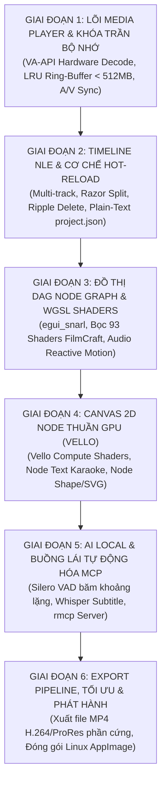

# BẢN KẾ HOẠCH TỔNG THỂ TOÀN DỰ ÁN: DARKWORKS (master-plan-a-z.md)
@project: DARKWORKS (GPU-Accelerated Node-Driven Video Editor)
@authority: Giám Đốc (Người Dùng) | @status: 🟡 Trình Duyệt Kế Hoạch (A-Z)
@architecture: 100% Pure Rust + wgpu + egui + vello | @ram_cap: < 512MB

> **Mục tiêu tài liệu:** Bản kế hoạch tác chiến trung tâm xâu chuỗi toàn bộ quá trình phát triển dự án Darkworks từ con số 0 đến phiên bản thương mại hoàn chỉnh.  
> Các đầu việc to (Epics / Tasks) được phân bổ theo 6 Giai đoạn (Phases) tuần tự, nghiệm thu dứt điểm từng bước, không nhảy cóc.

---

## 🗺️ TỔNG QUAN LỘ TRÌNH 6 GIAI ĐOẠN (A - Z ROADMAP)

---

## GIAI ĐOẠN 1: LÕI MEDIA PLAYER & KHÓA TRẦN BỘ NHỚ (PHASE 1)
**Mục tiêu:** Nạp video 1080p/4K dài 1 tiếng, phát mượt mà 60fps trên Viewport, đồng bộ âm thanh PipeWire/ALSA và khóa cứng mức trần RAM hệ thống `< 512MB`.

- [x] **Task 1.1 [Setup]:** Khởi tạo Cargo Workspace gốc, cấu hình lints `#![deny(clippy::unwrap_used, clippy::expect_used)]` và remote GitHub.
- [x] **Task 1.2 [UI Layout]:** Dựng khung giao diện 4 phân vùng cơ bản bằng `egui + wgpu` ([crates/ui](file:///mnt/Data/darkworks/crates/ui)) và nhúng font DejaVu Sans tiếng Việt + ký tự Symbol kỹ thuật.
- [ ] **Task 1.3 [Media Crate]:** Khởi tạo `crates/media`, mang lõi giải mã video phần cứng OS Native (Linux VA-API / NVDEC) từ `reference/filmcraft/crates/media` sang.
- [ ] **Task 1.4 [LRU Ring-Buffer]:** Triển khai `FrameCache` giới hạn cứng dung lượng frame đã giải mã trong RAM `< 512MB` (giải phóng kịp thời theo thuật toán Least Recently Used).
- [ ] **Task 1.5 [GPU Zero-Copy Texture]:** Ánh xạ trực tiếp khung hình giải mã sang `wgpu::Texture` đẩy thẳng vào Viewport, tuyệt đối không copy pixel ngược về CPU (Pixel Readback).
- [ ] **Task 1.6 [A/V Clock Sync]:** Tích hợp `cpal` phát âm thanh đồng bộ qua PipeWire/ALSA; đồng hồ âm thanh làm chuẩn (Audio-Clock Master) để hình ảnh bám theo tiếng.
- **Tiêu chuẩn nghiệm thu (DoD 1):** Mở video MP4 1080p 1 tiếng, bấm Spacebar Play/Pause tức thì, âm thanh khớp khẩu hình, đo RAM thực tế bằng `htop` luôn dưới 512MB.

---

## GIAI ĐOẠN 2: TIMELINE NLE & CƠ CHẾ HOT-RELOAD (PHASE 2)
**Mục tiêu:** Trục thời gian phi tuyến tính đa track hoàn chỉnh, thao tác cắt ghép phím tắt mượt mà, lưu trạng thái mở vào `project.json` với cơ chế File Watcher Hot-Reload tức thì.

- [ ] **Task 2.1 [Deterministic Tick Time]:** Tích hợp sâu cấu trúc `Tick` (`1s = 254_016_000_000 ticks`) cho toàn bộ phép toán cắt, trim, tua và đồng bộ timeline.
- [ ] **Task 2.2 [Playhead & Scrubbing]:** Hoàn thiện thanh Playhead quét thời gian thực; hỗ trợ tua nhanh (Scrubbing) mượt mà không khựng hình hay deadlock.
- [ ] **Task 2.3 [NLE Edit Tools]:**
  - Công cụ Cắt dao cạo (**Razor Split - Phím S**) tại vị trí Playhead.
  - Công cụ Xóa hút (**Ripple Delete - Phím X**) xóa clip và tự động dồn các clip phía sau lại.
  - Công cụ co dãn biên clip (Trim In / Trim Out / Drag handle) với cơ chế Snapping (hút dính mép).
- [ ] **Task 2.4 [Multi-Track Rendering]:** Xếp chồng các track theo thứ tự ưu tiên (V2 Canvas ở trên, V1 Video ở dưới, A1/A2 Audio mix tự động).
- [ ] **Task 2.5 [Waveform Audio]:** Trích xuất sóng âm bằng `symphonia` và vẽ Waveform thời gian thực dưới track Audio trên Timeline.
- [ ] **Task 2.6 [Plain-Text State & Hot-Reload]:** Lưu trữ dự án ra `project.json`. Tích hợp File Watcher ngầm: sửa `project.json` bằng CLI hoặc file text ➔ Timeline tự động cập nhật lại ngay lập tức.
- **Tiêu chuẩn nghiệm thu (DoD 2):** Cắt ghép, di chuyển clip mượt mà; sửa `project.json` bên ngoài là Timeline trong app cập nhật tức thì; không bao giờ bị lệch frame sau 30 phút phát.

---

## GIAI ĐOẠN 3: ĐỒ THỊ DAG NODE GRAPH & WGSL SHADERS (PHASE 3)
**Mục tiêu:** Thay thế hoàn toàn Linear Stack cũ kỹ bằng đồ thị DAG trực quan `egui_snarl`, tái sử dụng toàn bộ 93 Shader WGSL của FilmCraft thành các Node nguyên tử (Atomic Nodes).

- [ ] **Task 3.1 [Snarl Engine]:** Tích hợp thư viện `egui_snarl` vào `crates/node-graph`, xây dựng canvas nối dây trực quan (kéo thả socket, dây cong Bézier).
- [ ] **Task 3.2 [Atomic Nodes Foundation]:** Xây dựng 6 Node nguyên tử cơ bản:
  - `Node Video Source` (Đầu vào hình ảnh từ Media).
  - `Node Transform` (Vị trí X/Y, Scale, Rotation, Anchor point).
  - `Node Blend / Mix` (Hòa trộn 2 lớp video với 26 blend modes).
  - `Node Color Grade` (Basic Correction: Exposure, Contrast, Temp/Tint).
  - `Node Keyer` (Ultra Key / Tách phông xanh).
  - `Node Output` (Đầu ra Viewport / Render).
- [ ] **Task 3.3 [Porting 93 WGSL Shaders]:** Áp dụng chiến lược "Bọc ngoài & Thay ruột" để kế thừa toàn bộ 93 Shader WGSL từ `reference/filmcraft/crates/render` thành các Node hiệu ứng trong Darkworks.
- [ ] **Task 3.4 [Procedural Motion (Audio React)]:** Trích xuất tín hiệu âm thanh (Audio RMS Peak / Pitch) làm cổng ra Socket để cắm dây điều khiển thông số video (ví dụ: tiếng Bass đập làm video tự động Zoom hoặc viền phát sáng).
- [ ] **Task 3.5 [Preset System (.preset.json)]:** Đóng gói toàn bộ một cụm node phức tạp thành file `.preset.json` độc lập (Zero-code Extensibility) để người dùng có thể chia sẻ và tái sử dụng.
- **Tiêu chuẩn nghiệm thu (DoD 3):** Kéo thả nối dây hiệu ứng mượt mà 60fps; cắm dây âm thanh điều khiển được chuyển động video thời gian thực; nạp/xuất `.preset.json` chuẩn xác.

---

## GIAI ĐOẠN 4: CANVAS 2D NODE THUẦN GPU (VELLO) (PHASE 4)
**Mục tiêu:** Đưa engine đồ họa vector Vello + Cosmic-text vào mạng lưới Node Graph để tạo chữ Karaoke nhảy màu, biểu đồ, infographic vẽ trực tiếp bằng Compute Shader trên VRAM GPU (Zero-Copy).

- [ ] **Task 4.1 [Vello Compute Backend]:** Tích hợp `vello` và `cosmic-text` vào `crates/canvas-renderer`, dựng pipeline vẽ vector thẳng lên `wgpu::Texture` mà không cần CPU đọc lại pixel.
- [ ] **Task 4.2 [Node Text / Subtitle (Generator Node)]:**
  - Node chuyên biệt cho chữ: Nhập chuỗi văn bản, chọn font chữ, kích cỡ, viền chữ, căn lề.
  - Hỗ trợ chế độ chạy chữ Karaoke: Đổi màu chữ theo nhịp âm thanh dựa trên đơn vị `Tick`.
- [ ] **Task 4.3 [Node Shape / Vector (Generator Node)]:**
  - Node chuyên biệt vẽ hình khối: Hình chữ nhật bo góc (Rounded Rect), hình tròn, ngôi sao, đường cong Bézier.
  - Hỗ trợ nạp file `.svg` từ bên ngoài vào thành vector sắc nét vô cực ở mọi độ phân giải.
- [ ] **Task 4.4 [Node Canvas Composite]:** Cho phép gom cụm nhiều layer chữ và hình khối (như thanh tiêu đề tin tức Lower-third) thành một Node đồ họa thống nhất.
- **Tiêu chuẩn nghiệm thu (DoD 4):** Tạo được một đoạn phụ đề Karaoke nhảy màu theo giọng nói mượt mà 60fps; phóng to vector không bị vỡ hạt; không nhúng Chromium, tiết kiệm 1GB RAM so với web engine.

---

## GIAI ĐOẠN 5: AI LOCAL & BUỒNG LÁI TỰ ĐỘNG HÓA MCP (PHASE 5)
**Mục tiêu:** Tích hợp AI chạy Offline nội bộ (Silero VAD băm khoảng lặng, Whisper sinh phụ đề) và mở cổng MCP Server (`rmcp`) để AI Agent hoặc CLI ra lệnh điều khiển tự động.

- [ ] **Task 5.1 [Local Silero VAD Worker]:**
  - Tích hợp mô hình Silero VAD qua `ort` (ONNX Runtime) chạy trên luồng ngầm (`crates/ai-workers`).
  - Nút bấm `⚡ Auto Cut Silence`: Tự động dò các đoạn im lặng trong video/audio và thực hiện cắt (Split) + xóa hút (Ripple Delete) chỉ với 1 click.
- [ ] **Task 5.2 [Local Whisper Transcription]:**
  - Tích hợp mô hình Whisper / Moonshine offline nhận diện giọng nói tiếng Việt/tiếng Anh.
  - Tự động sinh danh sách subtitle clips gán thẳng vào Track `V2 Canvas / Subtitle`.
- [ ] **Task 5.3 [MCP Server & darkworks-cli]:**
  - Xây dựng cổng MCP Server nội bộ (`crates/automation`) bằng thư viện `rmcp`.
  - Phơi bày toàn bộ lệnh điều khiển (`Session::execute`): cắt clip, đặt preset, áp shader, tua playhead.
  - Cho phép Antigravity CLI kết nối và tự động dựng video từ prompt của người dùng.
- **Tiêu chuẩn nghiệm thu (DoD 5):** Bấm `Auto Cut Silence` băm sạch khoảng lặng của video 10 phút dưới 5 giây; gọi lệnh MCP từ terminal cắt ghép video thành công mà không cần chạm chuột.

---

## GIAI ĐOẠN 6: EXPORT PIPELINE, TỐI ƯU & PHÁT HÀNH (PHASE 6)
**Mục tiêu:** Xuất video ra file thành phẩm (H.264 / ProRes) tận dụng tăng tốc phần cứng GPU, đóng gói ứng dụng Linux độc lập (AppImage / Binary) và phát hành GitHub Release.

- [ ] **Task 6.1 [Export Render Pipeline]:**
  - Xây dựng luồng xuất file nền ngầm (Background Export Job) có thanh tiến trình và nút hủy.
  - Tận dụng encoder phần cứng Linux (VA-API / NVENC) để xuất MP4 H.264 và Apple ProRes 422 HQ.
- [ ] **Task 6.2 [Memory & Performance Profiling]:**
  - Kiểm toán rò rỉ bộ nhớ (VRAM / RAM) bằng công cụ `heaptrack` và `.agents/harness/check_file_size.py`.
  - Khóa chặt mức RAM dưới 512MB trong toàn bộ quá trình vừa preview vừa render.
- [ ] **Task 6.3 [Packaging & GitHub Release]:**
  - Đóng gói ứng dụng thành file thực thi duy nhất kèm icon và desktop launcher.
  - Chạy quy trình `/release-github` phát hành bản `v0.1.0-alpha` lên GitHub Release kèm Changelog chuẩn 3 tầng (What's New / Improvements / Fixes).
- **Tiêu chuẩn nghiệm thu (DoD 6):** Xuất thành phẩm video 1080p 60fps mượt mà, file mở phát được trên VLC/QuickTime/YouTube không lỗi; binary phân phối chạy được trên mọi bản phân phối Linux (Arch, Ubuntu, Fedora).

---

## 📌 QUY TẮC BẤT DI BẤT DỊCH TRONG TOÀN BỘ QUÁ TRÌNH THỰC THI
1. **Thiết quân luật #1:** Khi phát sinh lỗi, Agent phân tích nguyên nhân gốc rễ (RCA) và xin phép Người Dùng trước khi can thiệp vào code.
2. **Quy tắc < 700 dòng code:** Toàn bộ file mã nguồn giữ dưới 500 dòng (trần cứng 700 dòng). Khi file chạm 700 dòng, bắt buộc báo cáo Người Dùng để quyết định phương án (không tự ý refactor).
3. **Quy tắc Never Crash:** Deny toàn bộ `.unwrap()`, `.expect()`, `panic!()` trong production.
4. **Quy trình ca kíp:** Luôn mở ca bằng `/start_session` và kết thúc bằng `/end_session` (cập nhật 3 ngăn kéo tài liệu).
