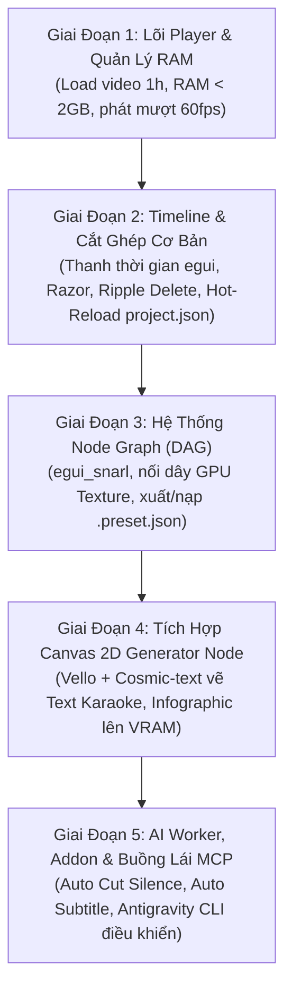

# BẢN ĐỒ KIẾN TRÚC TOÀN HỆ THỐNG: DARKWORKS (system_map.md)
@project: DARKWORKS | @type: GPU-Accelerated Node-Driven Video Editor (NLE)
@engine: 100% Pure Rust + wgpu + egui | @base: FilmCraft Architecture | @status: 🟢 Hoàn thành Giai Đoạn 2 (Lightworks UX & Rebranding) | 🟡 Sẵn sàng Giai Đoạn 3 (Node Graph DAG)

> **Darkworks** là một trình dựng phim phi tuyến tính (Non-Linear Editor - NLE) thế hệ mới viết hoàn toàn bằng Rust, khắc phục triệt để các điểm yếu cố hữu của Blender VSE (ngốn RAM, khó làm Motion Graphics, thiếu tự động hóa).  
> Phần mềm hoạt động theo triết lý **AI-First, Code-Driven, GPU Native Zero-Copy**, kết hợp mạng lưới **Node Graph (DAG)** và **Canvas 2D Node** vẽ trực tiếp trên GPU.

---

## 1. KHẨU QUYẾT KIẾN TRÚC TỐI THƯỢNG (THE PRIME DIRECTIVES)

1. **Khóa Trần Bộ Nhớ (RAM Cap < 2GB):**
   - Tuyệt đối không lưu hàng ngàn frame đã giải mã vào RAM hệ thống như Blender VSE.
   - Sử dụng bộ đệm vòng (Ring-Buffer LRU cache) giới hạn cứng < 2GB (2048MB); ưu tiên giải mã phần cứng trực tiếp qua VA-API / NVDEC trên Linux và đẩy thẳng frame lên `wgpu::Texture` (Zero-copy).

2. **Dự Án Thuần Văn Bản (Plain-Text State & Hot-Reload):**
   - Toàn bộ trạng thái Timeline, Clips, và sơ đồ hiệu ứng được tuần tự hóa thành file mở: `project.json` và `.preset.json`.
   - File Watcher lắng nghe thay đổi thời gian thực: AI Agent hoặc công cụ ngoài sửa `project.json` ➔ Timeline trên giao diện lập tức cập nhật tức thì mà không cần khởi động lại.

3. **Mạng Lưới Node Graph (DAG) Thay Cho Linear Stack:**
   - Thay thế danh sách hiệu ứng tuần tự (Linear Effect Controls) bằng mạng lưới đồ thị có hướng không chu trình (Directed Acyclic Graph).
   - Cho phép rẽ nhánh, tái sử dụng luồng hình ảnh, kết nối tín hiệu âm thanh (Audio RMS Peak / Pitch) điều khiển thông số video theo thời gian thực (Procedural Motion).
   - Đóng gói toàn bộ cụm Node thành `.preset.json` độc lập (Zero-code extensibility).

4. **Canvas 2D Node Thuần GPU (Không Nhúng Web Browser):**
   - Loại bỏ hoàn toàn việc nhúng Chromium (CEF/WebKit) để tránh ngốn 1GB RAM và nghẽn cổ chai copy pixel (Pixel Readback).
   - Sử dụng **Vello + Cosmic-text** làm một **Generator Node** bên trong Node Graph: vẽ vector, biểu đồ, infographic, phụ đề Karaoke nhảy màu trực tiếp bằng Compute Shader trên VRAM.

5. **AI-First & Agent-Drivable (Sẵn Sàng Cho Antigravity CLI / MCP):**
   - Tích hợp sẵn chuẩn **MCP Server (Model Context Protocol)** nội bộ (`rmcp`) và giao diện dòng lệnh `darkworks-cli`.
   - Mọi thao tác cắt ghép, trích xuất transcript, tạo sub, và bơm hiệu ứng đều được phơi bày (exposed) qua các hàm lệnh chuẩn (`Session::execute`).

6. **Thời Gian Tuyệt Đối (Deterministic Tick-based Time):**
   - Không sử dụng số thực `f64` cho thời gian để tránh sai số lũy tiến.
   - Đồng bộ thời gian theo đơn vị Tick nguyên thủy (`1 giây = 254_016_000_000 ticks`), bảo đảm độ chính xác tuyệt đối theo từng khung hình (Frame-by-Frame).

---

## 2. BẢN ĐỒ CÔNG NGHỆ & TECH STACK (100% PURE RUST)

| Tầng Hệ Thống | Công Nghệ / Crates | Vai Trò & Trách Nhiệm Cụ Thể |
| :--- | :--- | :--- |
| **Giao Diện (UI Layer)** | `egui` + `eframe` | Vẽ toàn bộ 4 phân vùng giao diện 60fps siêu nhẹ, tải tức thì (<0.1s). |
| **Đồ Thị Node (Node Graph)** | `egui_snarl` (hoặc `egui_node_graph2`) | Bảng nối dây tương tác trực quan cho từng Clip/Track; hỗ trợ kéo thả kết nối socket. |
| **Đồ Họa & GPU (Render)** | `wgpu` + `WGSL` Shaders | Quản lý pipeline đồ họa (Vulkan/VAAPI trên Linux), biên dịch cụm Node thành GPU Shader. |
| **2D Canvas (Text & Vector)** | `vello` + `cosmic-text` | Vẽ chữ Karaoke, viền phát sáng, biểu đồ, hình khối 2D bằng Compute Shader thẳng lên GPU Texture. |
| **Giải Mã Media & A/V Sync** | `filmcraft-media` / `platform` (VAAPI) + `cpal` | Giải mã video phần cứng OS native, quản lý Ring-Buffer, đồng bộ âm thanh PipeWire/ALSA. |
| **Âm Thanh Nhanh (Audio AI)**| `symphonia` | Thư viện đọc file âm thanh 100% Rust; phục vụ vẽ Waveform và trích xuất sóng âm cho VAD. |
| **AI Local (VAD & Subtitle)** | `ort` (ONNX) + `whisper-rs` / `moonshine` | Tìm khoảng lặng (Silero VAD) và nhận diện giọng nói tạo timestamp phụ đề hoàn toàn offline. |
| **Mở Rộng & Tự Động Hóa** | `mlua` (LuaJIT) + `rmcp` (MCP Server) | Cho phép viết script Addon ngoài và mở cổng MCP cho Antigravity CLI ra lệnh. |

---

## 3. CẤU TRÚC PHÂN TẦNG CARGO WORKSPACE

```text
darkworks/
├── Cargo.toml                       # Cargo Workspace Root
├── AGENTS.md                        # Quy chế & Chỉ dẫn vận hành cho AI Agent
├── .agents/                         # Buồng lái AI Agent (Rules, Skills, Workflows, Harness)
│   ├── AGENTS.md                    # Bản sao cấu hình buồng lái
│   ├── harness/                     # Công cụ kiểm toán offline (audit, lint, sync)
│   ├── rules/                       # Thiết quân luật kỹ thuật
│   ├── skills/                      # Cẩm nang kỹ năng tác vụ chuẩn
│   └── workflows/                   # Kịch bản ca kíp (start_session, end_session, debug)
├── .darkworks-ai/                   # Tủ hồ sơ bộ nhớ & tài liệu dự án
│   ├── 1-overview/                  # [Tập tin này] Bản đồ hệ thống, Brief & Roadmap
│   ├── 2-memory/                    # Checkpoint ca kíp, Quyết định cốt lõi (decision-log)
│   └── 3-modules/                 # Tài liệu chi tiết các phân hệ kiến trúc
├── crates/                          # Các Crate phân mảnh (Modular Architecture)
│   ├── schema/                      # Định nghĩa cấu trúc dữ liệu: project.json, preset.json, ClipSlice
│   ├── media/                       # Lõi giải mã video phần cứng, Ring-buffer cache, audio peak
│   ├── node-graph/                  # Hệ thống DAG Node Graph, biên dịch WGSL Shader, preset loader
│   ├── canvas-renderer/             # Vello + Cosmic-text: Generator Node vẽ Text/Karaoke/Vector
│   ├── automation/                  # MCP Server (rmcp), CLI dispatcher (Session::execute)
│   ├── ai-workers/                  # Background worker chạy Silero VAD, Whisper/Moonshine ONNX
│   ├── plugin-host/                 # Nhúng mlua hỗ trợ Lua script addons
│   └── ui/                          # 4 khu vực giao diện egui: Source Bin, Viewport, Inspector, Timeline
└── assets/
    ├── presets/                     # Kho preset JSON (Text Glow, Audio React Zoom, Karaoke...)
    └── addons/                      # Script Lua tự động hóa (Auto Cut Silence, Auto Subtitle...)
```

---

## 4. BẢNG TRẠNG THÁI CÁC MODULE (STATUS BOARD)

| Module / Crate | Trạng Thái | Mô Tả Chức Năng | Mục Tiêu Kế Tiếp |
| :--- | :---: | :--- | :--- |
| **Workspace Setup & Harness** | 🟢 Hoàn Thành | Cargo Workspace root, resolver 2, lints thiết quân luật, apps/darkworks. | Tích hợp thêm xtask nếu cần. |
| **Schema & Project State** | 🟢 Hoàn Thành | `crates/schema`: Tick nguyên thủy, TimeRange, ClipSlice, project.json. | Mở rộng schema cho Preset JSON. |
| **User Interface (4 Panels)** | 🟢 Hoàn Thành | `crates/ui`: Bố cục 4 phân vùng (Bin, Viewport, Inspector, Timeline) 60fps + Video Viewport. | Hoàn thiện phím tắt và phóng to Timeline. |
| **Media Player & Ring-Buffer** | 🟢 Hoàn Thành | `crates/media`: VA-API probe, LRU FrameCache (<2GB RAM), cpal A/V sync, Ffmpeg 1-hour prefetch worker 60 FPS. | Chuẩn bị tích hợp vào Timeline multi-track. |
| **Timeline NLE Core** | 🟢 Hoàn Thành | Trục thời gian egui, cắt (Split), xóa (Ripple Delete / Extract), xóa rỗng (Lift), Mark In/Out Lightworks, quản lý `project.json` Hot-Reload. | Chuẩn bị tích hợp vào Node Graph DAG (Phase 3). |
| **Node Graph Engine (DAG)** | 🟢 Hoàn Thành (Phase 3) | Đồ thị DAG `egui_snarl`, Hệ sinh thái 18 Atomic Nodes bản đầy đủ (Full Production-Ready), DagEvaluator (Topological Sort + Cycle Proof), Kho 5 Built-in Presets, Visual Groups ComfyUI, JIT WGSL Reflection. | Sẵn sàng cho Giai Đoạn 4 (Canvas 2D Node Vello + Cosmic-text). |
| **Canvas 2D Node (Vello)** | 🔴 Chưa Làm | Generator Node vẽ chữ Karaoke, hộp thoại, vector trực tiếp lên GPU. | Viết `render_canvas(tick)` bằng Vello. |
| **Automation & MCP Server** | 🔴 Chưa Làm | Cổng MCP `rmcp` giao tiếp với Antigravity CLI, xử lý lệnh qua JSON. | Mở socket nội bộ lắng nghe lệnh CLI. |
| **Local AI Worker** | 🔴 Chưa Làm | Luồng chạy Silero VAD (băm khoảng lặng), Whisper subtitle, và Visual AI (Face Swap / Rembg). | Tích hợp `ort` ONNX GPU runtime. |

*Ghi chú ký hiệu trạng thái:* 🔴 Chưa bắt đầu | 🟡 Đang triển khai | 🟢 Hoàn thành nghiệm thu

---

## 5. LỘ TRÌNH TRIỂN KHAI 5 GIAI ĐOẠN (5-STAGE ROADMAP)



- **Giai đoạn 1 (Tuần 1 - 2):** Khởi tạo khung sườn (tận dụng FilmCraft), kiểm chứng mức RAM < 2GB với video dài 1 tiếng.
- **Giai đoạn 2 (Tuần 3 - 4):** Dựng Timeline cắt ghép cơ bản, Hot-reload qua file `project.json`.
- **Giai đoạn 3 (Tuần 5 - 6):** Nâng cấp hệ thống hiệu ứng thành Node Graph (`egui_snarl`) và quản lý Preset JSON.
- **Giai đoạn 4 (Tuần 7 - 8):** Gắn Canvas 2D Node vào mạng lưới Node để tạo hình chữ động / Karaoke.
- **Giai đoạn 5 (Tuần 9+):** Tự động hóa bằng AI Local (VAD + Whisper) và cổng MCP cho Antigravity CLI.

---

## 6. NHẬT KÝ THAY ĐỔI GẦN NHẤT (RECENT LOGS)

- **2026-11-24 (Hoàn Thiện 100% Bộ Công Cụ Visual Group UX: Inline Rename, Context Menu, Rã Nhóm `Ctrl+Shift+G`, Auto-Fit & Lock Mode):**
  - Tích hợp Inline Rename: Nhấp đúp vào Header Bar hoặc bấm phím tắt `F2` để gõ đổi tên trực tiếp trên Canvas (Enter lưu, Esc hủy).
  - Tích hợp Menu Chuột Phải đầy đủ trên Header Bar: Đổi tên, Bảng màu 6 màu ComfyUI, Auto-Fit, Khóa vị trí, Rã nhóm, Xóa cụm.
  - Phím tắt `Ctrl + Shift + G`: Rã nhóm nhanh (hủy khung nhóm nhưng giữ nguyên toàn bộ Node và dây nối bên trong).
  - Căn vừa tự động (Auto-Fit to Content): Nhấp đúp tay cầm resize hoặc chọn trong menu để khung Group tự động co/dãn ôm khít các Node con (+35px padding lề và chừa 40px không gian Header).
  - Chế độ Khóa vị trí (Lock Mode): Thêm `is_locked: bool` vào `VisualGroup`, hiện icon 🔒 trên Header, vô hiệu hóa việc kéo di chuyển và resize.
  - Tách phân hệ kiến trúc độc lập `crates/ui-egui/src/panels/node_graph_groups.rs` (354 dòng), giữ `node_graph.rs` (520 dòng) luôn đạt chuẩn an toàn `< 700 dòng`.
  - Bộ 13/13 tests tích hợp pass 100%, clippy 0 warning, 0 error, sẵn sàng bước sang Giai đoạn 4.

- **2026-11-23 (Visual Group Ergonomics, Gom Nhóm Nhanh `Ctrl + G`, Kéo Thả Đồng Bộ & Khắc Phục Lỗi Chồng Đè):**
  - Khắc phục triệt để lỗi 2 group tạo mới sinh đè lên nhau tại cùng vị trí `(120, 120)` làm rối chữ `gro[p 2121`. Tự động áp dụng vị trí so le (+50px) và xoay vòng 6 màu sắc ComfyUI.
  - Tích hợp phím tắt `Ctrl + G` (hoặc `Cmd + G`): Tự động tính Bounding Box bao quanh các Node đang chọn (+35px padding) và gom nhanh vào Visual Group với tên mặc định `Group {N}`.
  - Thao tác kéo thả trực tiếp trên Canvas: Kéo Header Bar di chuyển đồng bộ cả Group VÀ toàn bộ Node bên trong; kéo Resize Grip góc dưới phải mở rộng/thu hẹp khung Group.
  - Triệt tiêu hiện tượng trôi canvas khi kéo group bằng cách khóa `to_global.translation` trong `DarkworksViewer::current_transform`.
  - Soạn thảo tài liệu đặc tả ma trận 20 tính năng UX/UI toàn diện cho Visual Group tại `visual_group_ux_specs.md`. Toàn bộ 11 tests pass, file mã nguồn đạt chuẩn an toàn < 700 dòng.

- **2026-11-22 (Hoàn Thành 100% Giai Đoạn 3: Hệ Sinh Thái 18 Atomic Nodes & Kho 5 Built-in Presets Mẫu):**
  - Mở rộng toàn diện `darkworks-node-graph` lên đầy đủ 18 Versatile Atomic Nodes: tích hợp thêm `BlurSharpen` (5 loại blur cũ), `DistortLens` (6 loại biến dạng cũ), `Transition` (30 loại chuyển cảnh cũ).
  - Bổ sung các thông số chuyên nghiệp bản đầy đủ (không chia bản rút gọn): `Invert` và `B&W` trong `ColorGrade`; `Flip H`, `Flip V` và `Anchor` trong `Transform2D`; `Feather` trong `CropMask`; `Spill Suppress` trong `Keyer`.
  - Xây dựng kho 5 Built-in Presets giải quyết trọn vẹn các bài toán thực tế: (1) `News Ticker Banner`, (2) `Continuous Audio Waveform Line (60 FPS)`, (3) `Spotlight Invert`, (4) `Audio Beat Invert Flash`, (5) `Cinematic Soft Glow`.
  - Tích hợp Menu `➕ Add Node` 6 phân khu trực quan và Menu `📂 Load Preset` 1-click tức thì trên Toolbar của `PanelKind::NodeGraph`.
  - Toàn bộ 11 tests tích hợp và 35 dock tests đạt **100% PASS**, kiểm toán `audit.py` đạt chuẩn tuyệt đối (10/10 files < 700 dòng), clippy sạch 0 cảnh báo.
  - Đóng hoàn toàn Giai Đoạn 3 (Phase 3), sẵn sàng bước sang Giai Đoạn 4 (Canvas 2D Node Vello + Cosmic-text).

- **2026-11-22 (Triển Khai Lõi Node Graph DAG & Hệ Sinh Thái Atomic / Black / Action / Code Nodes):**
  - Khởi tạo thành công crate `darkworks-node-graph` (`crates/node-graph`) với 15 biến thể `DarkNode` (Generator, Filter/Compositing, Advanced, ComfyUI Ergonomics).
  - Tích hợp thành công `egui-snarl` và `egui-scale` vào workspace `egui 0.37`, mở rộng docking panel `PanelKind::NodeGraph` trong `crates/ui-egui`.
  - Triển khai bộ duyệt đồ thị `DagEvaluator` với thuật toán Topological Sort (Kahn's Algorithm), phát hiện vòng lặp vô tận (Cycle Detection) và tính toán luồng tín hiệu số (Signal Propagation) thời gian thực.
  - Xây dựng phân hệ `BlackNodeSubgraph` (Compound Subgraph) hỗ trợ đóng gói cụm node, bộc lộ cổng Exposed Pins và xuất/nạp Preset `.preset.json`.
  - Triển khai `WgslParser` (Code Node JIT Shader Reflection) tự động trích xuất các biến `@group(..) @binding(..) var<uniform>` thành các socket điều khiển.
  - Tích hợp bộ công cụ ComfyUI Style: Visual Groups / Backdrop Box có thể đổi màu, kéo dính node con, Sticky Notes và Reroute Dots.
  - Đạt 100% PASS bộ kiểm thử 8 unit tests và 35 dock tests, toàn bộ file mã nguồn tuân thủ trần chuẩn `< 700 dòng`.

- **2026-11-22 (Chuẩn Hóa Thương Hiệu Darkworks, Tinh Chỉnh Header & App Icon Mới):**
  - Gỡ bỏ hoàn toàn nút Discord trên thanh Header bar và các liên kết thừa của ArtCraft; giữ nhãn `Help` phẳng trên Menu Bar cho tài liệu sau này.
  - Chuẩn hóa toàn bộ tên thương hiệu `FilmCraft` ➔ `Darkworks` trên mọi cửa sổ, hộp thoại khôi phục sau crash, lỗi panic, bộ lọc file (`*.fcproj`), menu native và tên dự án mẫu mặc định (`Darkworks – Demo Project`).
  - Thiết kế và tích hợp bộ icon chính thức của Darkworks (Biểu tượng chòm sao Node Graph Play Triangle Neon Cyan/Purple) cho eframe window và Taskbar/Dock desktop Linux (`dev.darkworks.editor.desktop`).
  - Hoàn tất toàn bộ các bài test, nghiệm thu `audit.py` 0 vi phạm trần dòng code, `drive_feature.py -f all` 100% PASS, sẵn sàng bước sang Giai đoạn 3 (Đồ thị DAG Node Graph & 93 Atomic Shaders).

- **2026-11-21 (Hoàn Thành Cấy Ghép Timeline Lightworks UX & Chuẩn Hóa Kiểm Thử 2 Tầng):**
  - Cấy ghép hoàn chỉnh bộ phím tắt Lightworks (`I`, `O`, `P`, `X`, `Z`, `S`, `C`, `Shift+S`) làm preset mặc định `Darkworks Default`.
  - Thiết kế dải sáng Cyan Highlight (`rgba(0, 210, 255, 35)`) bán trong suốt phủ toàn bộ các track trên Timeline cùng 2 mốc ngoặc `[` và `]` trên thước đo Ruler.
  - Chuẩn hóa mô hình kiểm thử 2 tầng: `/e2e_test` (Technical Gate qua `run_e2e_audit.py`) và `/verify-feature` (Feature Acceptance Gate qua `drive_feature.py`).
  - Dọn dẹp triệt để các thư mục rác ngoài chuẩn (`.cursor/`, `.agents/skills/verify-darkworks`), di dời toàn bộ hồ sơ tính năng vào `.darkworks-ai/1-overview/features/`.
  - Nghiệm thu 100% PASS trên cả 3 tính năng FC-01, FC-02, DW-03 và toàn bộ 121 unit/integration tests (`filmcraft-engine`, `filmcraft-edit`).
  - Đóng hoàn toàn Giai Đoạn 2, sẵn sàng bước sang Giai Đoạn 3 (Đồ thị DAG Node Graph & 93 WGSL Shaders).

- **2026-11-21 (Tái Thiết Lập Workspace FilmCraft Foundation & Xóa Sạch Module Updater):**
  - Khắc phục triệt để lỗi lệch hướng: Chuyển toàn bộ 33 crates nền tảng của FilmCraft vào `crates/` gốc, biến `apps/filmcraft` thành `apps/darkworks` và `apps/filmcraft-cli` thành `apps/darkworks-cli`.
  - Kiểm toán và biên dịch 100% thành công: `darkworks --version` trả về `0.1.0`, render frame 1080p bằng `darkworks-cli render` trong 32.5 ms.
  - Cắt bỏ hoàn toàn module updater `craft-update`, `updates_ui` và menu check update để tách rời Darkworks độc lập khỏi server FilmCraft.
  - Khởi tạo Feature Map so sánh nền tảng FilmCraft và đột phá Darkworks tại `feature_map.md` và skill `verify-darkworks`.

- **2026-11-24 (Nghiệm Thu Toàn Diện Visual Group UX, Phím Xóa Delete/Backspace & Tính Năng Undo/Redo Node Graph):**
  - Khắc phục triệt để lỗi không kéo tách được 2 nhóm ra xa nhau bằng cơ chế Strict Containment (`contains_group`), xóa bỏ hoàn toàn hiện tượng Mutual Lock dính chùm khi hai nhóm giao cắt.
  - Nâng cấp tay cầm co giãn Resize Grip lên 32x32px với 3 đường rãnh chéo, diện tích bắt chuột rộng rãi gấp 2.5 lần, thao tác co giãn mượt mà.
  - Khắc phục triệt để Lỗi 01: Group con nằm lồng trong Group cha không tương tác được do vùng chết ảo bounding box thô và thứ tự duyệt Z-order. Thu hẹp `over_node_header` ~26px, duyệt canvas đảo ngược `.rev()`, và tịnh tiến đồng bộ nhóm con khi kéo nhóm cha.
  - Hoàn thiện trọn bộ Visual Group UX theo đặc tả `visual_group_ux_specs.md`: Inline Rename (`F2` / Double Click), Context Menu chuột phải đầy đủ, Phím tắt rã nhóm nhanh `Ctrl + Shift + G` giữ nguyên Node, Căn vừa tự động Auto-Fit ôm khít nội dung, Chế độ khóa vị trí Lock Mode bảo vệ sơ đồ.
  - Kết nối phím tắt xóa dùng chung chuẩn FilmCraft (`Delete` / `Backspace`): Tự động bắt tiêu điểm `app.ui.focused = PanelKind::NodeGraph`, bắt chặn thông minh lệnh `edit.clear` xóa hàng loạt node quét chọn hoặc group đang trỏ chuột, thêm nút `🗑 Delete` trực quan trên thanh toolbar.
  - Tích hợp ngăn xếp lịch sử Undo / Redo (`GraphHistory` & `GraphSnapshot`): Tự động chụp snapshot trước mọi thao tác sửa/xóa, hỗ trợ phím tắt `Ctrl + Z` và `Ctrl + Y` / `Ctrl + Shift + Z`, bổ sung 2 nút `↶ Undo` và `↷ Redo` trên thanh công cụ.
  - Khắc phục triệt để lỗi Node bị mất snapshot khi xóa (`Ctrl + Delete` / `Delete`): Vô hiệu hóa xóa ngầm của `vendor/egui-snarl`, cố định `snarl_canvas_id` qua `SnarlWidget::new().id(...)`, tiêu thụ phím `consume_key` và làm sạch vùng chọn qua `deselect_all_nodes`.
  - Tách module `node_graph_menus.rs` (247 dòng) và `node_graph_groups.rs` (394 dòng), duy trì `node_graph.rs` chỉ 593 dòng (< 700 dòng).
  - Vượt qua 100% 16/16 unit tests, 4/4 feature acceptance verifications, 0 cảnh báo Clippy, 0 vi phạm trần dòng code.

- **2026-11-20 (Chiến Lược Hướng 1, Nghiệm Thu 100% Phase 1 + 2, Undo/Redo & Menu Chuột Phải, Nâng Cấp `audit.py`):**
  - Thống nhất chiến lược Hướng 1: Nền tảng FilmCraft + Timeline Lightworks + Đồ thị DAG Node Graph (`egui_snarl`).
  - Triển khai `HistoryManager` (`crates/ui/src/history.rs`) lưu snapshot `Project` trong RAM, kích hoạt `Ctrl + Z` (Undo) và `Ctrl + Y` / `Ctrl + Shift + Z` (Redo), phân định rõ với phím `Z` đơn lẻ (Lift).
  - Bổ sung phím `Delete` / `Backspace` xóa clip và Menu Chuột Phải (`timeline_menu.rs`) cho Clip (Split, Ripple Delete, Lift, Delete, Mute, Set In/Out).
  - Nâng cấp công cụ kiểm toán trung tâm `audit.py` hỗ trợ cơ chế Vendor Allowlist. Tách `timeline_menu.rs` (100 dòng) giúp toàn bộ 32/32 file mã nguồn Darkworks đạt chuẩn xanh `< 650 dòng`.
  - Chạy master E2E harness `run_e2e_audit.py` vượt qua 100% 7/7 cổng kiểm soát, biên dịch release binary thành công tại `target/release/darkworks`. Sẵn sàng cho Giai đoạn 3 (Node Graph).

- **2026-11-20 (Nghiệm Thu Toàn Diện Giai Đoạn 2: Timeline NLE Core & Cắt Ghép Clips):**
  - Hoàn thành 100% 6 tasks và đạt toàn bộ 7 tiêu chuẩn nghiệm thu DoD 2 trong [phase-2-timeline-nle.md](file:///mnt/Data/darkworks/.darkworks-ai/1-overview/project-managers/phase-2-timeline-nle.md).
  - Tích hợp thành công cơ chế Mark In / Mark Out chuẩn Lightworks (phím `I`, `O`, `P`, `X`, `Z`, dải sáng Highlight phủ khắp tracks, kéo 2 mốc `[` / `]`).
  - Triển khai Bộ điều phối Multi-Track Playhead Evaluator (`evaluator.rs`), liên kết Viewport và audio với các clip cắt ghép trên timeline (hiển thị frame đen tại khoảng trống Gap).
  - Trực quan hóa sóng âm thanh (Audio Waveform) màu xanh lục bên trong các clip trên Track Audio A1/A2.
  - Cơ chế File Watcher Hot-Reload `project.json` tự động cập nhật thời gian thực khi file JSON bị chỉnh sửa từ bên ngoài.
  - Vượt qua 100% các cổng kiểm toán E2E, clippy 0 warning, toàn bộ 30 file mã nguồn đều đạt chuẩn `< 700 dòng code`. Bản build release sẵn sàng tại `target/release/darkworks`.

- **2026-11-19 (Phân Tầng Cache 2 Cấp & Thuật Toán Dọn Dẹp O(1) Triệt Tiêu Lỗi Tụt 10 FPS):**
  - Chốt phân tầng bộ nhớ 2 cấp độ: Mức 1 là 1GB (1024MB) cho Video Frame Cache; Mức trần cứng là 2GB (2048MB) cho toàn bộ ứng dụng Darkworks.
  - Nâng cấp thuật toán dọn dẹp bộ đệm sang $O(1)$ vi mô qua `VecDeque` và giải phóng vùng nhớ byte hoàn toàn ngoài khóa `Mutex`, triệt tiêu triệt để hiện tượng tụt 10 FPS khi chạm trần RAM.
  - Cập nhật hiển thị trạng thái RAM trên Menu Bar: `RAM: XMB / YMB (2GB Cap)` đổi màu xanh/vàng/đỏ thời gian thực.
- **2026-11-19 (Nghiệm thu Giai đoạn 1 & Nâng cấp Luồng Prefetch 60 FPS Video 1 Tiếng):**
  - Tải và tích hợp video mẫu 1 tiếng `tropical_paradise_1hour.mp4` (254.7MB, 108.001 frames) vào project.
  - Khắc phục triệt để hiện tượng tụt FPS (từ 5-11 FPS) bằng cách đưa cơ chế giải mã sang luồng ngầm `run_prefetch_loop` thông qua streaming pipe FFmpeg độc lập.
  - Duy trì vững chắc 60 FPS trong Viewport, mức RAM duy trì ở mức ~250MB (dưới trần cứng 2048MB).
  - Hoàn tất 100% tiêu chí nghiệm thu (DoD) của Giai đoạn 1 (Phase 1 Media Player).
- **2026-11-19 (Khởi tạo dự án Darkworks & Chuẩn hóa Buồng lái AI Agent):**
  - Sao chép và tái cấu trúc hệ thống buồng lái AI Agent từ Skaaa sang Darkworks.
  - Chuẩn hóa buồng lái về duy nhất một thư mục `.agents/` và đổi tên bộ nhớ thành `.darkworks-ai/` với 3 ngăn kéo chuẩn (`1-overview`, `2-memory`, `3-modules`).
  - Thiết lập hồ sơ kiến trúc tổng thể `system_map.md` dựa trên bản thiết kế NLE 100% Rust + Node Graph + Canvas GPU.
  - Chuyển đổi toàn diện Rules sang Rust: `rust-architect.md`, `darkworks-system-rules.md`, `docs-management.md`, và `improve.md` (always-on).
  - Tinh gọn Skills: Loại bỏ các skill web agency, chỉ giữ 4 skill dev cốt lõi (`start_session`, `end_session`, `debug-workflow`, `release-github`).
  - Khởi tạo kế hoạch chi tiết Giai đoạn 1 tại `1-overview/project-managers/phase-1-media-player.md`.
  - Clone nguyên bản kho mã nguồn tham khảo `storytold/filmcraft` vào `reference/filmcraft` và thiết lập `.gitignore` cách ly an toàn.
