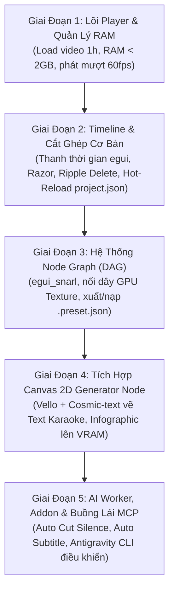

# BẢN ĐỒ KIẾN TRÚC TOÀN HỆ THỐNG: DARKWORKS (system_map.md)
@project: DARKWORKS | @type: GPU-Accelerated Node-Driven Video Editor (NLE)
@engine: 100% Pure Rust + wgpu + egui | @base: FilmCraft Architecture | @status: 🟡 Setup & Architectural Blueprint

> **Darkworks** là một trình dựng phim phi tuyến tính (Non-Linear Editor - NLE) thế hệ mới viết hoàn toàn bằng Rust, khắc phục triệt để các điểm yếu cố hữu của Blender VSE (ngốn RAM, khó làm Motion Graphics, thiếu tự động hóa).  
> Phần mềm hoạt động theo triết lý **AI-First, Code-Driven, GPU Native Zero-Copy**, kết hợp mạng lưới **Node Graph (DAG)** và **Canvas 2D Node** vẽ trực tiếp trên GPU.

---

## 1. KHẨU QUYẾT KIẾN TRÚC TỐI THƯỢNG (THE PRIME DIRECTIVES)

1. **Khóa Trần Bộ Nhớ (RAM Cap < 2GB):**
   - Tuyệt đối không lưu hàng ngàn frame đã giải mã vào RAM hệ thống như Blender VSE.
   - Sử dụng bộ đệm vòng (Ring-Buffer LRU cache) giới hạn cứng < 2GB (2048MB); ưu tiên giải mã phần cứng trực tiếp qua VA-API / NVDEC trên Linux và đẩy thẳng frame lên `wgpu::Texture` (Zero-copy).

2. **Dự Án Thuần Văn Bản (Plain-Text State & Hot-Reload):**
   - Toàn bộ trạng thái Timeline, Clips, và sơ đồ hiệu ứng được tuần tự hóa thành file mở: `project.json` và `.preset.json`.
   - File Watcher lắng nghe thay đổi thời gian thực: AI Agent hoặc công cụ ngoài sửa `project.json` ➔ Timeline trên giao diện lập tức cập nhật tức thì mà không cần khởi động lại.

3. **Mạng Lưới Node Graph (DAG) Thay Cho Linear Stack:**
   - Thay thế danh sách hiệu ứng tuần tự (Linear Effect Controls) bằng mạng lưới đồ thị có hướng không chu trình (Directed Acyclic Graph).
   - Cho phép rẽ nhánh, tái sử dụng luồng hình ảnh, kết nối tín hiệu âm thanh (Audio RMS Peak / Pitch) điều khiển thông số video theo thời gian thực (Procedural Motion).
   - Đóng gói toàn bộ cụm Node thành `.preset.json` độc lập (Zero-code extensibility).

4. **Canvas 2D Node Thuần GPU (Không Nhúng Web Browser):**
   - Loại bỏ hoàn toàn việc nhúng Chromium (CEF/WebKit) để tránh ngốn 1GB RAM và nghẽn cổ chai copy pixel (Pixel Readback).
   - Sử dụng **Vello + Cosmic-text** làm một **Generator Node** bên trong Node Graph: vẽ vector, biểu đồ, infographic, phụ đề Karaoke nhảy màu trực tiếp bằng Compute Shader trên VRAM.

5. **AI-First & Agent-Drivable (Sẵn Sàng Cho Antigravity CLI / MCP):**
   - Tích hợp sẵn chuẩn **MCP Server (Model Context Protocol)** nội bộ (`rmcp`) và giao diện dòng lệnh `darkworks-cli`.
   - Mọi thao tác cắt ghép, trích xuất transcript, tạo sub, và bơm hiệu ứng đều được phơi bày (exposed) qua các hàm lệnh chuẩn (`Session::execute`).

6. **Thời Gian Tuyệt Đối (Deterministic Tick-based Time):**
   - Không sử dụng số thực `f64` cho thời gian để tránh sai số lũy tiến.
   - Đồng bộ thời gian theo đơn vị Tick nguyên thủy (`1 giây = 254_016_000_000 ticks`), bảo đảm độ chính xác tuyệt đối theo từng khung hình (Frame-by-Frame).

---

## 2. BẢN ĐỒ CÔNG NGHỆ & TECH STACK (100% PURE RUST)

| Tầng Hệ Thống | Công Nghệ / Crates | Vai Trò & Trách Nhiệm Cụ Thể |
| :--- | :--- | :--- |
| **Giao Diện (UI Layer)** | `egui` + `eframe` | Vẽ toàn bộ 4 phân vùng giao diện 60fps siêu nhẹ, tải tức thì (<0.1s). |
| **Đồ Thị Node (Node Graph)** | `egui_snarl` (hoặc `egui_node_graph2`) | Bảng nối dây tương tác trực quan cho từng Clip/Track; hỗ trợ kéo thả kết nối socket. |
| **Đồ Họa & GPU (Render)** | `wgpu` + `WGSL` Shaders | Quản lý pipeline đồ họa (Vulkan/VAAPI trên Linux), biên dịch cụm Node thành GPU Shader. |
| **2D Canvas (Text & Vector)** | `vello` + `cosmic-text` | Vẽ chữ Karaoke, viền phát sáng, biểu đồ, hình khối 2D bằng Compute Shader thẳng lên GPU Texture. |
| **Giải Mã Media & A/V Sync** | `filmcraft-media` / `platform` (VAAPI) + `cpal` | Giải mã video phần cứng OS native, quản lý Ring-Buffer, đồng bộ âm thanh PipeWire/ALSA. |
| **Âm Thanh Nhanh (Audio AI)**| `symphonia` | Thư viện đọc file âm thanh 100% Rust; phục vụ vẽ Waveform và trích xuất sóng âm cho VAD. |
| **AI Local (VAD & Subtitle)** | `ort` (ONNX) + `whisper-rs` / `moonshine` | Tìm khoảng lặng (Silero VAD) và nhận diện giọng nói tạo timestamp phụ đề hoàn toàn offline. |
| **Mở Rộng & Tự Động Hóa** | `mlua` (LuaJIT) + `rmcp` (MCP Server) | Cho phép viết script Addon ngoài và mở cổng MCP cho Antigravity CLI ra lệnh. |

---

## 3. CẤU TRÚC PHÂN TẦNG CARGO WORKSPACE

```text
darkworks/
├── Cargo.toml                       # Cargo Workspace Root
├── AGENTS.md                        # Quy chế & Chỉ dẫn vận hành cho AI Agent
├── .agents/                         # Buồng lái AI Agent (Rules, Skills, Workflows, Harness)
│   ├── AGENTS.md                    # Bản sao cấu hình buồng lái
│   ├── harness/                     # Công cụ kiểm toán offline (audit, lint, sync)
│   ├── rules/                       # Thiết quân luật kỹ thuật
│   ├── skills/                      # Cẩm nang kỹ năng tác vụ chuẩn
│   └── workflows/                   # Kịch bản ca kíp (start_session, end_session, debug)
├── .darkworks-ai/                   # Tủ hồ sơ bộ nhớ & tài liệu dự án
│   ├── 1-overview/                  # [Tập tin này] Bản đồ hệ thống, Brief & Roadmap
│   ├── 2-memory/                    # Checkpoint ca kíp, Quyết định cốt lõi (decision-log)
│   └── 3-modules/                 # Tài liệu chi tiết các phân hệ kiến trúc
├── crates/                          # Các Crate phân mảnh (Modular Architecture)
│   ├── schema/                      # Định nghĩa cấu trúc dữ liệu: project.json, preset.json, ClipSlice
│   ├── media/                       # Lõi giải mã video phần cứng, Ring-buffer cache, audio peak
│   ├── node-graph/                  # Hệ thống DAG Node Graph, biên dịch WGSL Shader, preset loader
│   ├── canvas-renderer/             # Vello + Cosmic-text: Generator Node vẽ Text/Karaoke/Vector
│   ├── automation/                  # MCP Server (rmcp), CLI dispatcher (Session::execute)
│   ├── ai-workers/                  # Background worker chạy Silero VAD, Whisper/Moonshine ONNX
│   ├── plugin-host/                 # Nhúng mlua hỗ trợ Lua script addons
│   └── ui/                          # 4 khu vực giao diện egui: Source Bin, Viewport, Inspector, Timeline
└── assets/
    ├── presets/                     # Kho preset JSON (Text Glow, Audio React Zoom, Karaoke...)
    └── addons/                      # Script Lua tự động hóa (Auto Cut Silence, Auto Subtitle...)
```

---

## 4. BẢNG TRẠNG THÁI CÁC MODULE (STATUS BOARD)

| Module / Crate | Trạng Thái | Mô Tả Chức Năng | Mục Tiêu Kế Tiếp |
| :--- | :---: | :--- | :--- |
| **Workspace Setup & Harness** | 🟢 Hoàn Thành | Cargo Workspace root, resolver 2, lints thiết quân luật, apps/darkworks. | Tích hợp thêm xtask nếu cần. |
| **Schema & Project State** | 🟢 Hoàn Thành | `crates/schema`: Tick nguyên thủy, TimeRange, ClipSlice, project.json. | Mở rộng schema cho Preset JSON. |
| **User Interface (4 Panels)** | 🟡 Khung Sườn Sẵn Sàng | `crates/ui`: Bố cục 4 phân vùng (Bin, Viewport, Inspector, Timeline) 60fps. | Nhúng wgpu::Texture video render thật. |
| **Media Player & Ring-Buffer** | 🔴 Chưa Làm | Lõi giải mã phần cứng GPU (VA-API), giới hạn RAM < 2GB, A/V Sync mượt. | Tích hợp lõi media từ FilmCraft base sang `crates/media`. |
| **Timeline NLE Core** | 🔴 Chưa Làm | Trục thời gian egui, cắt (Split), xóa (Ripple Delete), quản lý `project.json`. | Định nghĩa `ClipSlice` và Hot-Reload watcher. |
| **Node Graph Engine (DAG)** | 🔴 Chưa Làm | Bảng nối dây `egui_snarl`, truyền `wgpu::Texture`, biên dịch shader. | Tạo 6 node nguyên tử đầu tiên (Transform, Blend, Color...). |
| **Canvas 2D Node (Vello)** | 🔴 Chưa Làm | Generator Node vẽ chữ Karaoke, hộp thoại, vector trực tiếp lên GPU. | Viết `render_canvas(tick)` bằng Vello. |
| **Automation & MCP Server** | 🔴 Chưa Làm | Cổng MCP `rmcp` giao tiếp với Antigravity CLI, xử lý lệnh qua JSON. | Mở socket nội bộ lắng nghe lệnh CLI. |
| **Local AI Worker** | 🔴 Chưa Làm | Luồng chạy Silero VAD (băm khoảng lặng) và Whisper local. | Tích hợp `ort` ONNX runtime. |

*Ghi chú ký hiệu trạng thái:* 🔴 Chưa bắt đầu | 🟡 Đang triển khai | 🟢 Hoàn thành nghiệm thu

---

## 5. LỘ TRÌNH TRIỂN KHAI 5 GIAI ĐOẠN (5-STAGE ROADMAP)



- **Giai đoạn 1 (Tuần 1 - 2):** Khởi tạo khung sườn (tận dụng FilmCraft), kiểm chứng mức RAM < 2GB với video dài 1 tiếng.
- **Giai đoạn 2 (Tuần 3 - 4):** Dựng Timeline cắt ghép cơ bản, Hot-reload qua file `project.json`.
- **Giai đoạn 3 (Tuần 5 - 6):** Nâng cấp hệ thống hiệu ứng thành Node Graph (`egui_snarl`) và quản lý Preset JSON.
- **Giai đoạn 4 (Tuần 7 - 8):** Gắn Canvas 2D Node vào mạng lưới Node để tạo hình chữ động / Karaoke.
- **Giai đoạn 5 (Tuần 9+):** Tự động hóa bằng AI Local (VAD + Whisper) và cổng MCP cho Antigravity CLI.

---

## 6. NHẬT KÝ THAY ĐỔI GẦN NHẤT (RECENT LOGS)

- **2026-11-19 (Khởi tạo dự án Darkworks & Chuẩn hóa Buồng lái AI Agent):**
  - Sao chép và tái cấu trúc hệ thống buồng lái AI Agent từ Skaaa sang Darkworks.
  - Chuẩn hóa buồng lái về duy nhất một thư mục `.agents/` và đổi tên bộ nhớ thành `.darkworks-ai/` với 3 ngăn kéo chuẩn (`1-overview`, `2-memory`, `3-modules`).
  - Thiết lập hồ sơ kiến trúc tổng thể `system_map.md` dựa trên bản thiết kế NLE 100% Rust + Node Graph + Canvas GPU.
  - Chuyển đổi toàn diện Rules sang Rust: `rust-architect.md`, `darkworks-system-rules.md`, `docs-management.md`, và `improve.md` (always-on).
  - Tinh gọn Skills: Loại bỏ các skill web agency, chỉ giữ 4 skill dev cốt lõi (`start_session`, `end_session`, `debug-workflow`, `release-github`).
  - Khởi tạo kế hoạch chi tiết Giai đoạn 1 tại `1-overview/project-managers/phase-1-media-player.md`.
  - Clone nguyên bản kho mã nguồn tham khảo `storytold/filmcraft` vào `reference/filmcraft` và thiết lập `.gitignore` cách ly an toàn.
