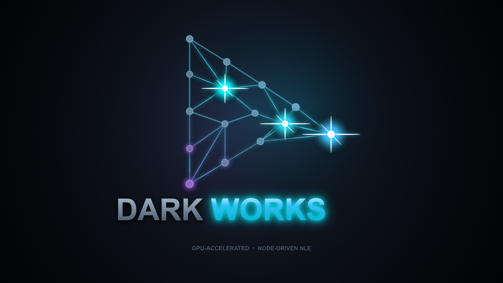
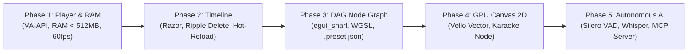

<p align="center">
  
</p>

<p align="center">
  <b>GPU-Accelerated, Node-Driven Non-Linear Video Editor (NLE) Built in Pure Rust.</b>
</p>

<p align="center">
  
  
  
  
  
  
</p>

<br>

**Darkworks** is a next-generation non-linear video editor (NLE) engineered from the bitstream up in pure Rust. It combines a high-performance **GPU Zero-Copy** rendering pipeline with a visual **DAG Node Graph** and a pure **GPU Vector Canvas** — overcoming the sluggishness, memory bloat, and rigid linear workflows of traditional editors.

---

## ⚡ The Prime Directives (Khẩu Quyết Kiến Trúc)

1. **Khóa Trần Bộ Nhớ (RAM Cap < 512MB):**
   - Strictly bounded Ring-Buffer LRU cache. No unbounded frame buffering in system RAM like Blender VSE.
   - OS-native hardware decoding (Linux VA-API / NVDEC) maps frames directly to `wgpu::Texture` (Zero-copy).

2. **Mạng Lưới Đồ Thị DAG Node Graph (Thay Cho Linear Stack):**
   - Replaces the rigid Premiere-style vertical effect stack with a Directed Acyclic Graph powered by `egui_snarl`.
   - Supports parallel branch compositing, visual asset reuse, and procedural motion (e.g., Audio RMS Peak / Pitch directly driving video transforms and glow in real-time).
   - Bundles complete node clusters into reusable `.preset.json` files.

3. **Canvas 2D Node Thuần GPU (Không Nhúng Web Browser):**
   - No heavy Chromium/CEF/WebKit runtimes (saving 1GB+ RAM and eliminating CPU pixel readback bottlenecks).
   - Powered by **Vello + Cosmic-text** as a native **Generator Node**: renders vector paths, infographics, and kinetic/karaoke subtitles directly using Compute Shaders on VRAM.

4. **Dự Án Thuần Văn Bản (Plain-Text State & Hot-Reload):**
   - Complete timeline, clips, and graph states are serialized into human-readable `project.json` and `.preset.json`.
   - Real-time File Watcher: external AI agents, scripts, or CLI commands modifying `project.json` update the live UI instantly without app restarts.

5. **AI-First & Điều Khiển Qua CLI / MCP Server:**
   - Internal Model Context Protocol (**MCP Server**) and `darkworks-cli` command dispatcher (`Session::execute`).
   - Automated workflows: silence removal (Silero VAD), local speech-to-text (Whisper/Moonshine ONNX), and auto-cut pipelines.

6. **Thời Gian Tuyệt Đối (Deterministic Tick-based Time):**
   - Exact integer ticks (`1 second = 254,016,000,000 ticks`). Eliminates floating-point drift across mixed frame rates (23.976, 29.97, 60fps) and audio sample rates.

---

## 🏗️ Architecture & Workspace Structure

Darkworks enforces strict separation of concerns across layered Cargo crates:

```text
darkworks/
├── apps/
│   └── darkworks/                   # Main desktop binary entry point (eframe runner)
├── crates/
│   ├── schema/                      # Lightweight data definitions: project.json, ClipSlice, Presets
│   ├── media/                       # VA-API hardware decoding, LRU Ring-Buffer frame cache, A/V sync
│   ├── node-graph/                  # egui_snarl DAG graph, WGSL shader compiler, preset loader
│   ├── canvas-renderer/             # Vello + Cosmic-text: GPU vector & text generator node
│   ├── automation/                  # MCP Server (rmcp), CLI dispatcher (Session::execute)
│   ├── ai-workers/                  # Background worker: Silero VAD & local Whisper ONNX
│   └── ui/                          # egui 4-panel NLE interface (Bin, Viewport, Inspector, Timeline)
├── assets/
│   ├── branding/                    # Official Darkworks brand assets & canvas templates
│   └── presets/                     # Pre-packaged node presets (Glow, Audio Reactive, Karaoke)
└── reference/filmcraft/             # Reference engine code (isolated in .gitignore)
```

---

## 🛠️ Tech Stack

| Subsystem | Technology | Responsibility |
| :--- | :--- | :--- |
| **Giao Diện (UI)** | `egui` + `eframe` | Lightweight, immediate-mode 60fps desktop interface |
| **Đồ Thị Node** | `egui_snarl` | Node canvas for visual wiring, parameter binding, socket connections |
| **Đồ Họa & GPU** | `wgpu` + `WGSL` | Vulkan/Metal rendering pipeline, real-time shader compositing |
| **2D Vector & Chữ** | `vello` + `cosmic-text` | GPU Compute Shader vector rendering, kinetic typography & Karaoke |
| **Giải Mã Media** | Linux VA-API / NVDEC + `cpal` | Hardware video decoding, LRU frame cache, sample-accurate audio |
| **AI Local** | `ort` (ONNX) + Silero VAD | Offline silence detection & speech recognition (Whisper) |
| **Tự Động Hóa** | `rmcp` (MCP Server) | External control for AI Coding Agents and CLI automation |

---

## 🗺️ 5-Stage Roadmap



- [x] **Setup:** AI Agent cockpit (`.agents/`), 3-drawer memory (`.darkworks-ai/`), official brand design.
- [ ] **Phase 1 (In Progress):** Cargo workspace setup, 4-panel `crates/ui`, hardware media player with bounded `< 512MB` LRU cache.
- [ ] **Phase 2:** Multi-track timeline, playhead scrubbing, split/ripple tools, `project.json` file watcher.
- [ ] **Phase 3:** `egui_snarl` node graph, audio peak reactive motion, 90+ WGSL shader nodes.
- [ ] **Phase 4:** Vello compute-shader vector engine, text styling, dynamic karaoke highlighting.
- [ ] **Phase 5:** Local Silero VAD auto-cut, Whisper transcription, MCP server integration.

---

## 🚀 Building & Running

### Prerequisites (Linux)
- **Rust Toolchain:** Stable (1.85+) or Nightly (`rustup update`)
- **Graphics Drivers:** Vulkan drivers & VA-API libraries (`libva`, `vulkan-loader`)
- **Audio:** PipeWire or ALSA headers (`libasound2-dev` / `alsa-lib`)

### Build
```bash
# Clone the repository
git clone https://github.com/chiconcota/darkworks.git
cd darkworks

# Check workspace integrity
cargo check --workspace

# Run the desktop application
cargo run --release -p darkworks
```

---

## 📜 License & Acknowledgments

- **License:** Licensed under the [MIT License](LICENSE).
- **Inspirations & Base:** Inspired by and leveraging foundational concepts from the pure-Rust editor [FilmCraft](https://github.com/storytold/filmcraft) and modern Rust graphics engines ([Linebender / Vello](https://github.com/linebender/vello)).
